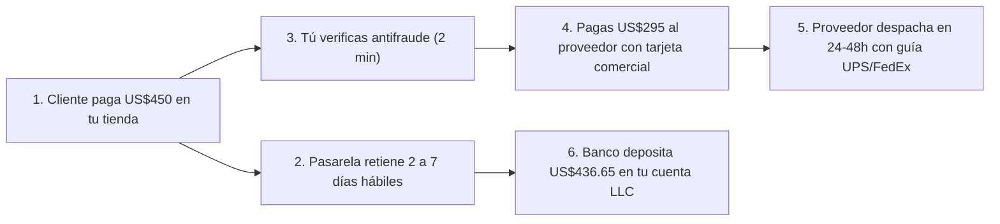

# 📄 Hoja de Referencia Visual (Cheat Sheet) — Módulo 00

## 1. Low-Ticket (Impulso) vs. High-Ticket Bilingüe (Consultivo)

| Variable Operativa | Dropshipping Tradicional (Low-Ticket) | Tu Modelo High-Ticket Bilingüe (EE. UU.) |
| :--- | :--- | :--- |
| **Precio de Venta** | US$15 a US$45 | **US$150 a US$800** |
| **Ganancia Neta por Pedido** | US$3 a US$8 (frágil ante subidas de CPA) | **US$40 a US$150+ netos** |
| **Tamaño del Catálogo** | 50 a 500 productos genéricos sin foco | **3 a 10 productos seleccionados con lupa** |
| **Origen del Proveedor** | Asia (AliExpress / intermediarios, 10–25 días) | **Bodegas domésticas en EE. UU. (4–7 días hábiles)** |
| **Pedidos para ganar US$2,500/mes** | 350 a 600 pedidos mensuales (alto estrés) | **30 a 50 pedidos mensuales (~1 a 2 por día)** |
| **Tu Ventaja Competitiva** | Guerra de precios y anuncios virales | **Atención humana por Teléfono y WhatsApp (EN/ES)** |

---

## 2. Regla del Flujo de Caja (Cash Flow) en Tickets Altos

---

## 3. Los 4 Riesgos Reales y su Antídoto Operativo

1. **Proveedor sin stock (*Out of Stock*):** Verificar inventario semanalmente y tener siempre al menos 2 proveedores autorizados en EE. UU. para tu categoría.
2. **Retención en pasarela de pagos (*Account Hold*):** Subir siempre el número de guía (*tracking*) el mismo día del despacho y llamar al cliente en órdenes mayores a US$400.
3. **Contracargos (*Chargebacks*):** Activar validación *AVS/CVV*, nunca enviar a casilleros internacionales sospechosos y confirmar por teléfono pedidos de riesgo medio.
4. **Quemar presupuesto en anuncios:** No lanzar campañas sin antes conocer tu *CPA Máximo* y tener activo el botón de WhatsApp y teléfono para rescatar indecisos.
