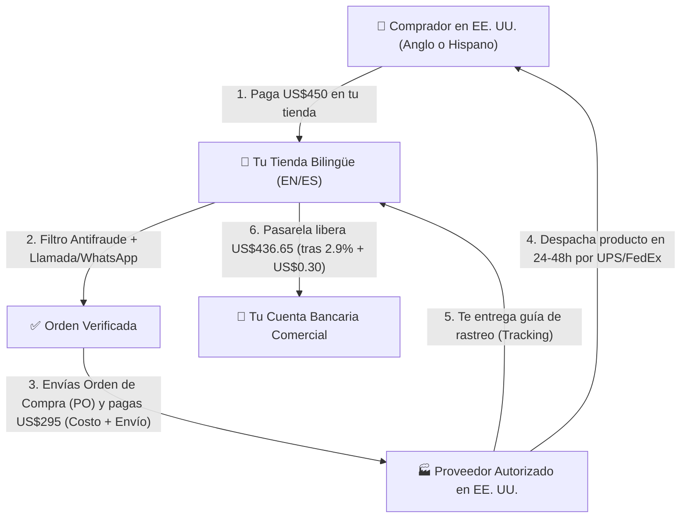

## 🎯 Objetivo de la Lección
Comprender cómo funciona operativamente el **dropshipping de alto valor (*high-ticket dropshipping*)** en Estados Unidos, por qué su economía unitaria (*unit economics*) es superior a la venta de productos baratos y cuántos pedidos mensuales necesitas realmente para alcanzar una meta de **US$2,500 de ganancia neta al mes**.

---

## 📖 Explicación Sencilla

El **dropshipping** es un método de cumplimiento logístico (*order fulfillment*), no un negocio mágico para hacerse rico sin trabajar. Consiste en que tú operas la tienda comercial, atraes al cliente, brindas asesoría preventa y cobras el pedido, mientras que un **fabricante o distribuidor mayorista autorizado (*Authorized Dealer*)** almacena el producto en su bodega dentro de Estados Unidos y lo envía directamente a la puerta de tu comprador.

La mayoría de los principiantes fracasan porque intentan el modelo de **bajo valor (*low-ticket*)**: vender artículos impulsivos de US$20 a US$35 enviados desde el extranjero. Cuando descuentas el producto, el envío y el costo publicitario (*CPA - Cost Per Acquisition*), quedan apenas US$4 o US$5 de ganancia (o pérdidas directas).

En cambio, en el **modelo de alto valor (*high-ticket*)** que construirás en este curso:
1. Vendes artículos duraderos y funcionales entre **US$150 y US$800** (ej. equipamiento comercial ligero, mobiliario especializado, energía portátil, accesorios de patio o taller).
2. Trabajas únicamente con **proveedores con inventario físico en EE. UU.** que despachan por *UPS, FedEx* o transporte de carga (*LTL Freight*) en **4 a 7 días hábiles**.
3. Cada venta te deja una **ganancia neta mínima de US$40** (y frecuentemente entre **US$60 y US$120 netos**) después de todos los gastos.

### Recurso Visual 1: Flujo Real de un Pedido y del Dinero



---

### Recurso Visual 2: ¿Cuántos pedidos al mes necesitas para ganar US$2,500 netos?

Observa la diferencia matemática entre intentar ganar **US$2,500 libres al mes** vendiendo baratijas de US$25 frente a operar un catálogo selecto de alto valor:

```chart
{
  "type": "bar",
  "title": "Pedidos Mensuales Necesarios para Lograr US$2,500 de Ganancia Neta",
  "data": {
    "labels": [
      "Low-Ticket (US$28 venta / US$5 netos)",
      "High-Ticket Base (US$220 venta / US$42 netos)",
      "High-Ticket Óptimo (US$450 venta / US$68 netos)",
      "High-Ticket + Cierre Telefónico (US$680 venta / US$105 netos)"
    ],
    "datasets": [
      {
        "label": "Pedidos requeridos por mes",
        "data": [500, 60, 37, 24],
        "backgroundColor": ["#EF4444", "#F59E0B", "#10B981", "#2563EB"]
      }
    ]
  }
}
```

> [!EJEMPLO_NUMEROS]
> **Ejemplo con números reales (Perfil Base: Meta US$2,500/mes con 12 h/semana):**
> Supongamos que vendes un calentador de patio comercial o una estación de trabajo ergonómica a un precio oficial (*MAP - Minimum Advertised Price*) de **US$450.00**:
> * **Precio cobrado al cliente:** `US$450.00` (envío incluido en el precio)
> * **Costo mayorista del proveedor (*COGS*):** `-US$260.00` (supuesto: margen mayorista del 42.2%)
> * **Envío doméstico por UPS Ground en EE. UU.:** `-US$35.00`
> * **Comisión de pasarela de pago:** `-US$13.35` *(Tarifa verificada de Shopify Payments Plan Basic en EE. UU.: **2.9% + US$0.30** para tarjetas domésticas estándar; Fuente: Shopify US Pricing 2026)*.
> * **Provisión para devoluciones y contracargos (3%):** `-US$13.50`
> * **Costo por Adquisición en publicidad (*CPA* en Google Shopping):** `-US$60.00`
> * **= GANANCIA NETA REAL POR PEDIDO:** **`+US$68.15`** (cumple ampliamente tu criterio de >= US$40 netos).
>
> **¿Qué significa esto para tu meta?** Para ganar **US$2,500 netos al mes** (más **US$39/mes** de la suscripción del plan Basic de Shopify), necesitas `US$2,539 ÷ US$68.15 = 37.2` -> **38 pedidos al mes** (apenas **1.26 pedidos por día**). Atender 1 o 2 pedidos diarios es totalmente viable con **12 horas por semana**.

> [!ANGLO_VS_HISPANO]
> **Mercado Anglo vs. Hispano en EE. UU. (Datos verificados, sin estereotipos):**
> * Según el **Pew Research Center**, la población hispana en EE. UU. alcanza los **68 millones de personas** (cerca del **20% de la población total del país**, o 1 de cada 5 habitantes) y ha impulsado el **56% del crecimiento demográfico de EE. UU.** entre 2000 y 2024.
> * Según el informe **LDC U.S. Latino GDP Report** (elaborado junto con *Arizona State University*), el PIB de los latinos en EE. UU. alcanzó los **US$4.4 billones (*trillions*)** con un poder adquisitivo de **US$4.1 billones**, lo que representa la **4.ª economía más grande del mundo** si fuera un país independiente, creciendo a más del doble de velocidad que el resto de la economía estadounidense.
> * **Implicación práctica para tu negocio:** La inmensa mayoría de las tiendas *high-ticket* en EE. UU. atienden únicamente en inglés y con soporte frío por correo electrónico. Al ofrecer **la misma tienda con localización real en español e inglés y atención humana por teléfono/WhatsApp**, capturas un mercado con altísimo poder de compra y mucha menor competencia publicitaria.

> [!ERROR_COMUN]
> **Confundir "Margen Bruto" con "Ganancia Neta":** Muchos novatos ven un producto que cuesta US$140 en el proveedor y se vende en US$200 y creen que ganarán US$60. Olvidan restar US$25 de envío, US$6.10 de pasarela de pago y US$35 de publicidad, terminando con una **pérdida de -US$6.10 por cada venta**. En este curso solo aprobamos productos donde la **ganancia neta final sea de al menos US$40**.

---

## 🛠️ Ejercicio Práctico Aplicado a tu Negocio
Abre la calculadora del portal (o tu plantilla `m00-carta-operativa-personal.md`) y define tu meta de pedidos mensuales:
1. Toma tu meta mensual base de **US$2,500 netos**.
2. Calcúlala en dos escenarios de ganancia neta por orden: el mínimo aceptable del curso (**US$40 netos/orden** = 63 pedidos/mes) y el objetivo recomendado (**US$70 netos/orden** = 36 pedidos/mes).
3. Anota en tu Carta Operativa qué días y horas de tus **12 horas semanales** dedicarás a responder llamadas o mensajes de clientes.

---

## ✅ Checklist de la Lección
- [ ] Entiendo la diferencia entre el margen bruto del proveedor y mi ganancia neta después de envío, pasarela, publicidad y devoluciones.
- [ ] Verifiqué cómo fluye el dinero desde que el cliente paga hasta que la pasarela deposita en el banco.
- [ ] Descargué la plantilla de mi Carta Operativa Personal (`m00-carta-operativa-personal.md`).

---

## 🧠 Mini Quiz de Comprobación

```quiz
[
  {
    "pregunta": "1. Si vendes un artículo en US$300, el proveedor te cobra US$175 de producto + US$25 de envío, la pasarela cobra US$9.00 (2.9% + US$0.30), reservas US$9.00 para devoluciones y gastas US$45 en publicidad (CPA), ¿cuál es tu ganancia neta real y cumple el criterio del curso?",
    "opciones": [
      "Ganas US$100.00 netos y sí cumple el criterio.",
      "Ganas US$37.00 netos y NO cumple el criterio mínimo de US$40 netos por pedido.",
      "Ganas US$82.00 netos y sí cumple el criterio.",
      "Pierdes US$12.00 en la operación."
    ],
    "correcta": 1,
    "explicacion": "US$300 - US$175 (COGS) - US$25 (Envío) - US$9 (Pasarela) - US$9 (Devoluciones) - US$45 (CPA) = US$37.00 netos. Como es menor a nuestro mínimo estricto de US$40, debemos negociar mejor costo o buscar un ticket mayor."
  },
  {
    "pregunta": "2. Verdadero o Falso: En el modelo high-ticket que aplicaremos, cuando un cliente paga US$500 con tarjeta en tu tienda nueva, ese mismo dinero siempre está libre en tu cuenta bancaria al minuto siguiente para pagarle al proveedor.",
    "opciones": [
      "Verdadero: las pasarelas transfieren los fondos en 60 segundos.",
      "Falso: los procesadores tardan entre 2 y 7 días hábiles en depositar (y pueden aplicar reservas iniciales), por lo que necesitas capital de trabajo o tarjeta comercial para pagar al proveedor y despachar a tiempo."
    ],
    "correcta": 1,
    "explicacion": "En ecommerce real, el procesador (Shopify Payments / Stripe) liquida en 2 a 5 días hábiles. Por eso necesitas una tarjeta de crédito o fondo de maniobra para comprar el producto al proveedor en las primeras 24-48h sin retrasar el envío."
  },
  {
    "pregunta": "3. Según los datos del Pew Research Center y el informe LDC U.S. Latino GDP, ¿por qué es estratégico operar tu tienda para el mercado anglo e hispano de EE. UU. simultáneamente?",
    "opciones": [
      "Porque en español no hay que pagar impuestos ni publicidad.",
      "Porque el mercado hispano en EE. UU. representa ~68 millones de personas y US$4.1 billones en poder adquisitivo, con menor saturación de tiendas especializadas que ofrezcan soporte humano en su idioma.",
      "Porque los productos hispanos no requieren garantía de fábrica.",
      "Porque Google prohíbe anunciar en inglés a empresas nuevas."
    ],
    "correcta": 1,
    "explicacion": "El mercado hispano en EE. UU. equivale a la 4.ª economía mundial en PIB (US$4.4 billones) y tiene un perfil joven y móvil, pero pocas tiendas high-ticket le ofrecen atención consultiva localizada en español."
  },
  {
    "pregunta": "4. ¿Cuál es la tarifa estándar de procesamiento de tarjetas domésticas online en el plan Basic de Shopify EE. UU. usando Shopify Payments?",
    "opciones": [
      "0% sin comisión por transacción.",
      "2.9% + US$0.30 por transacción.",
      "15% del valor total como en Amazon.",
      "10% fijo por cada pedido."
    ],
    "correcta": 1,
    "explicacion": "En el plan Basic de Shopify US (US$39/mes mensual o US$29/mes anual), la tarifa de Shopify Payments para tarjetas domésticas estándar es 2.9% + US$0.30."
  }
]
```

---

## 🎯 Entregable de la Lección
Completa la **Sección 1 (Mis Parámetros Base de Negocio)** dentro de la plantilla descargable **`m00-carta-operativa-personal.md`**.
