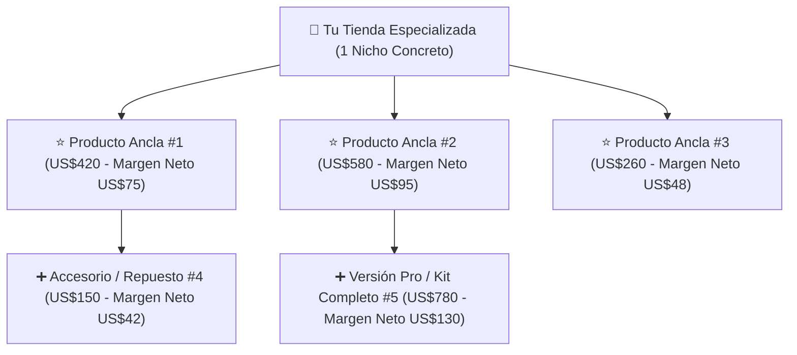

## 🎯 Objetivo de la Lección
Entender por qué limitar tu tienda a un **catálogo pequeño y especializado de 3 a 10 productos** reduce tu carga operativa a menos de 12 horas semanales, aumenta la confianza del comprador de alto valor y te permite dominar técnicamente cada artículo cuando un cliente llama o escribe por WhatsApp.

---

## 📖 Explicación Sencilla

Uno de los mitos más dañinos del comercio electrónico es creer que *"cuantos más productos subas a la tienda, más venderás"*. En productos de **US$150 a US$800**, ocurre exactamente lo contrario:

1. **El comprador de alto valor busca a un especialista, no un bazar:** Nadie compra una estación de energía solar de US$550 o una cortadora comercial de US$420 en una tienda que también vende juguetes para perro y fundas de celular.
2. **Dominio técnico para tu venta telefónica:** Como tu gran fortaleza es la **venta por teléfono y la atención al cliente**, si tienes solo **5 productos estrella**, en una tarde aprendes sus medidas, voltaje, garantía, peso y compatibilidad. Cuando un cliente anglo o hispano te llama, respondes con seguridad en 30 segundos y cierras la venta. Si tuvieras 800 productos, no sabrías qué responder.
3. **Mantenimiento de inventario y precios en 15 minutos:** Auditar el *stock* y el precio *MAP* de 5 a 10 productos te toma 15 minutos a la semana.

### Recurso Visual 1: Arquitectura del Catálogo Especializado (Modelo "Estrella + Satélites")



---

### Recurso Visual 2: Impacto del Tamaño del Catálogo en la Conversión y Horas de Gestión

```chart
{
  "type": "bar",
  "title": "Comparativa Operativa: Catálogo Corto (3-10 SKUs) vs. Catálogo Masivo (300+ SKUs)",
  "data": {
    "labels": [
      "Tasa de Conversión Promedio (%)",
      "Horas Semanales de Mantenimiento",
      "Tasa de Cierre por Teléfono/WhatsApp (%)"
    ],
    "datasets": [
      {
        "label": "Tu Catálogo Corto (3 a 10 Productos)",
        "data": [2.4, 3.5, 28],
        "backgroundColor": "#4F46E5"
      },
      {
        "label": "Tienda Genérica Masiva (300+ Productos)",
        "data": [0.7, 22, 6],
        "backgroundColor": "#94A3B8"
      }
    ]
  }
}
```

> [!EJEMPLO_NUMEROS]
> **Ejemplo con números (Por qué 5 productos bien trabajados superan a 500 productos abandonados):**
> *(Escenario ilustrativo basado en un presupuesto de prueba de US$600/mes en Google Shopping con CPC promedio de US$1.50 = 400 clics al mes)*:
> * **Tienda Masiva (500 SKUs sin optimizar):** Los 400 clics se dispersan entre 200 productos sin reseñas ni páginas cuidadas. Tasa de conversión: `0.5%` = **2 ventas al mes**.
> * **Tu Tienda de Catálogo Corto (5 SKUs ultra-optimizados en EN/ES + atención por WhatsApp/teléfono):** Los 400 clics van a 5 páginas impecables, con tabla comparativa en ambos idiomas y botón de consulta directa. De 400 visitantes, 25 te escriben o llaman con dudas; gracias a tu experiencia en atención al cliente cierras a 6 de ellos (24%), más 3 que compran directo en la web = **9 ventas al mes** (`2.25%` de conversión total). Con **US$65 de ganancia neta por orden**, generas **US$585 netos** en tu primer mes de prueba con el mismo tráfico.

> [!ANGLO_VS_HISPANO]
> **Mercado Anglo vs. Hispano: Cómo evalúan tu catálogo de 3 a 10 productos:**
> * **Comprador Anglo:** Valora encontrar una **tabla comparativa técnica clara** (*Comparison Chart*) entre tus 3 o 5 modelos ("Modelo Residencial vs. Modelo Comercial"), manuales descargables en PDF (fichas de especificaciones o *Spec Sheets*) y claridad en el cumplimiento de estándares de EE. UU. (ej. certificación *UL / ETL / NSF*).
> * **Comprador Hispano en EE. UU.:** Además de las especificaciones, valora enormemente la **guía consultiva rápida**: poder preguntar por WhatsApp o teléfono *"¿Cuál de los 3 modelos me recomiendas para mi negocio de comida / para mi casa en Houston?"*. Tener un catálogo corto de 3 a 10 productos te convierte en un asesor experto inmediato en ambos idiomas.

> [!ERROR_COMUN]
> **Mezclar categorías inconexas en el mismo catálogo corto:** Tener 6 productos no significa poner 1 cafetera espresso, 1 kayak, 1 lámpara de techo y 1 compresor de aire. Tus **3 a 10 productos deben pertenecer a la misma familia o resolver problemas del mismo perfil de cliente** para que tu tienda proyecte autoridad de marca y puedas vender productos complementarios (*cross-selling*).

---

## 🛠️ Ejercicio Práctico Aplicado a tu Negocio
Imagina que un cliente te llama por teléfono mientras estás en tus horas de trabajo. ¿Con cuántos productos te sientes 100% capaz de memorizar precios, tiempos de envío, garantías y especificaciones técnicas en tu primer mes?
1. Fija tu **número inicial de lanzamiento** en **5 productos principales** (pudiendo expandir a 10 en el Día 60).
2. Registra esta regla en la Sección 2 de tu plantilla `m00-carta-operativa-personal.md`.

---

## ✅ Checklist de la Lección
- [ ] Comprendí por qué un catálogo de 3 a 10 productos del mismo nicho proyecta mayor confianza y autoridad.
- [ ] Entendí el modelo "Productos Ancla + Accesorios/Versiones Superiores".
- [ ] Definí que empezaré con 3 a 5 productos en el lanzamiento antes de escalar hasta 10 productos.

---

## 🧠 Mini Quiz de Comprobación

```quiz
[
  {
    "pregunta": "1. ¿Cuál es la ventaja principal de operar un catálogo de 3 a 10 productos cuando tienes experiencia en ventas telefónicas y atención al cliente?",
    "opciones": [
      "No tienes que poner precios en la página web.",
      "Puedes conocer a fondo las especificaciones, envío y garantía de cada producto para responder con total autoridad y cerrar ventas por teléfono o WhatsApp.",
      "Los proveedores te regalan las muestras sin costo.",
      "No necesitas configurar pasarela de pagos."
    ],
    "correcta": 1,
    "explicacion": "Con 3 a 10 productos dominas cada detalle técnico, lo que te permite asesorar con seguridad tanto en inglés como en español y triplicar tu conversión frente a tiendas genéricas."
  },
  {
    "pregunta": "2. En un catálogo corto de 6 productos, ¿cómo deben relacionarse los artículos entre sí?",
    "opciones": [
      "Deben ser de 6 industrias totalmente distintas para probar suerte.",
      "Deben pertenecer al mismo nicho o servir al mismo perfil de comprador (ej. 3 modelos principales en distintos rangos de precio entre US$150 y US$800 más 3 variantes o complementos).",
      "Todos deben costar exactamente lo mismo.",
      "Deben ser productos de menos de US$20."
    ],
    "correcta": 1,
    "explicacion": "La coherencia del catálogo hace que tu tienda luzca como un distribuidor especializado (Authorized Dealer) y permite comparar opciones dentro de la misma tienda."
  },
  {
    "pregunta": "3. Verdadero o Falso: Para aprobar Google Merchant Center y cuentas con proveedores mayoristas en EE. UU., es obligatorio tener al menos 200 productos cargados en la tienda.",
    "opciones": [
      "Verdadero: menos de 200 productos causa rechazo automático.",
      "Falso: los proveedores B2B y Google Merchant Center evalúan la legitimidad, claridad de políticas, datos de contacto reales y calidad de presentación, prefiriendo tiendas especializadas sobre catálogos masivos copiados."
    ],
    "correcta": 1,
    "explicacion": "Una tienda enfocada con 3 a 10 productos bien documentados, políticas visibles y teléfono real genera mucha más confianza en auditores B2B y en Google."
  }
]
```

---

## 🎯 Entregable de la Lección
Deja firmada la **Sección 2 (Mis Reglas Innegociables de Catálogo: 3 a 10 productos coherentes)** en tu archivo `m00-carta-operativa-personal.md`.
