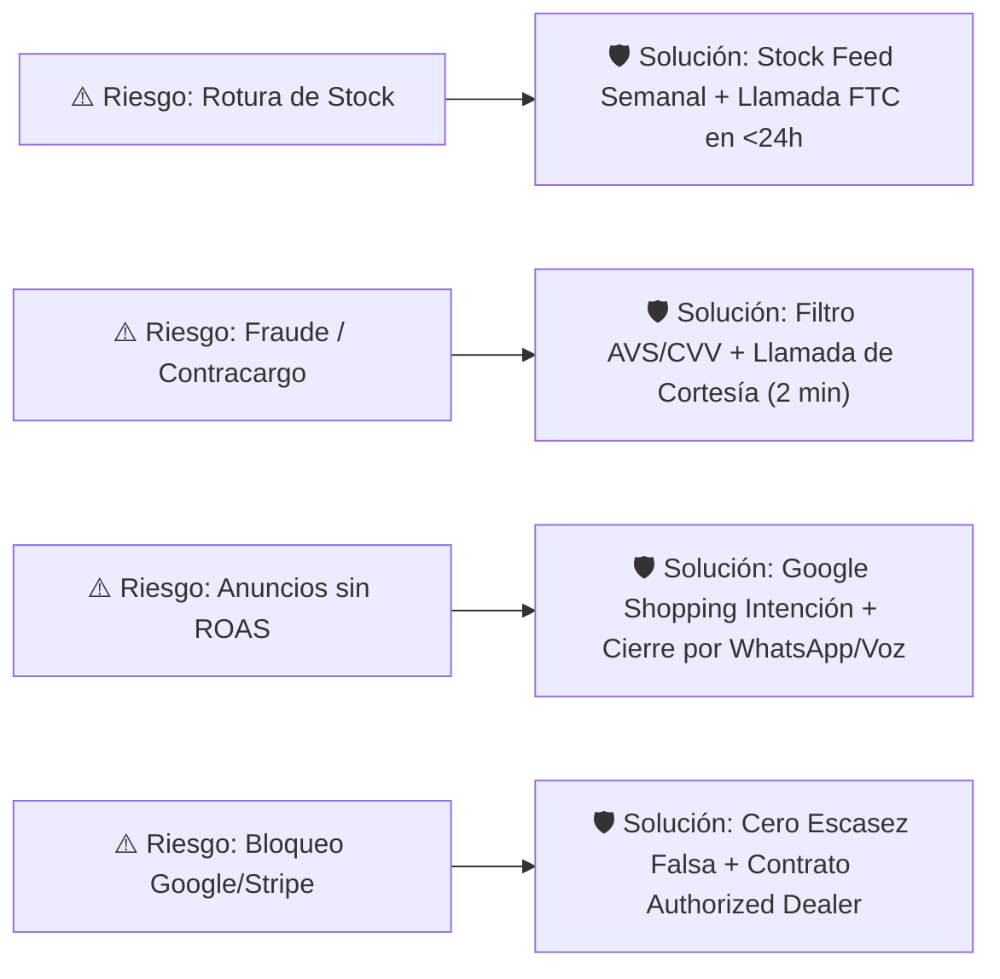

## 🎯 Objetivo de la Lección
Identificar con total transparencia los **riesgos reales** de operar un negocio de *dropshipping* de alto valor, establecer las **reglas éticas innegociables** que protegen tu empresa en EE. UU. y cuantificar cómo tu experiencia en **ventas por teléfono y atención al cliente** reduce esos riesgos.

---

## 📖 Explicación Sencilla

En este curso **no prometemos dinero fácil ni automático**. Operar un comercio electrónico de productos de **US$150 a US$800** es construir una empresa comercial real en Estados Unidos. Quienes pierden dinero en este modelo suelen hacerlo por ignorar cuatro riesgos operativos muy concretos o por usar trucos engañosos que terminan en el cierre de sus cuentas publicitarias y bancarias.

Veamos cada riesgo de frente y el protocolo exacto que usarás para neutralizarlo:

1. **Riesgo 1: Proveedores que se quedan sin inventario (*Out-of-Stock*) o retrasan el despacho.**
   * *Qué pasa si no te proteges:* Cobras US$500, vas a pedirle al proveedor y te dice que el producto estará agotado por 3 semanas. El cliente se molesta y pide un contracargo.
   * *Tu escudo:* Sincronización semanal de inventario, publicar en tu tienda un margen de seguridad de 1 a 2 días hábiles adicionales en el tiempo de preparación (*handling time*), y cumplir la regla de la **FTC (*Mail, Internet, or Telephone Order Merchandise Rule*)**: si un envío se retrasa, llamas al cliente el mismo día para ofrecerle un modelo superior disponible o el reembolso inmediato al 100%.
2. **Riesgo 2: Contracargos (*Chargebacks*) y fraude con tarjetas robadas.**
   * *Qué pasa si no te proteges:* Un estafador compra un artículo de US$650 con una tarjeta robada, tú lo envías y 30 días después el banco del titular real te quita los US$650 más US$15 de penalización, perdiendo además el producto.
   * *Tu escudo:* El **Semáforo Antifraude (Módulo 6)**. En tickets altos tienes pocos pedidos al día; dedicar **2 minutos a llamar por teléfono** a cualquier comprador cuya dirección de envío no coincida con la de facturación elimina casi por completo el fraude.
3. **Riesgo 3: Anuncios que consumen presupuesto sin generar ventas.**
   * *Qué pasa si no te proteges:* Dejas corriendo campañas en automático sin medir el costo por clic ni rescatar a los visitantes indecisos.
   * *Tu escudo:* Regla de *Stop-Loss* (pausa automática si un producto gasta 1.5 veces tu *CPA Máximo* sin ventas) y **Conversión Consultiva (Módulo 9)** por teléfono y WhatsApp.
4. **Riesgo 4: Suspensiones por prácticas engañosas o violación de marca.**
   * *Qué está terminantemente prohibido en tu negocio:*
     * ❌ Contadores de cuenta regresiva falsos (*"¡Oferta termina en 04:59 minutos!"*).
     * ❌ Pop-ups de compras inventadas (*"Juan en Miami acaba de comprar hace 2 minutos"*).
     * ❌ Precios "antes" inflados artificialmente que nunca existieron.
     * ❌ Prometer *"Entrega en 2 días gratis"* cuando el proveedor tarda 6 días hábiles.
     * ❌ Vender productos de marcas registradas sin tener aprobación escrita como distribuidor.

### Recurso Visual 1: Matriz de Blindaje Operativo y Ético



---

### Recurso Visual 2: Cómo tu Habilidad Telefónica Protege tu Rentabilidad

Observa en este gráfico (basado en nuestro modelo financiero de un producto de **US$480** con **US$1,000 de inversión publicitaria**) qué ocurre cuando combinas tráfico digital con tu **atención telefónica y por WhatsApp**:

```chart
{
  "type": "bar",
  "title": "Resultado con US$1,000 de Publicidad: Sin Atención Consultiva vs. Con Cierre Telefónico/WhatsApp",
  "data": {
    "labels": [
      "Ventas Cerradas (Pedidos)",
      "Costo por Adquisición CPA (US$)",
      "Ganancia Neta Total después de Ads (US$)"
    ],
    "datasets": [
      {
        "label": "Solo Checkout Frío (Sin Teléfono/WhatsApp)",
        "data": [9, 111, 80],
        "backgroundColor": "#F59E0B"
      },
      {
        "label": "Con tu Cierre Telefónico/WhatsApp Bilingüe",
        "data": [16, 62.5, 920],
        "backgroundColor": "#10B981"
      }
    ]
  }
}
```

> [!EJEMPLO_NUMEROS]
> **Ejemplo con números (Por qué una llamada de 3 minutos vale más de US$70):**
> *(Supuestos del ejemplo: Producto de US$480, Margen antes de publicidad de US$120 por orden, Gasto en anuncios de US$1,000 generando 600 visitas calificadas)*:
> * **Sin atención telefónica/WhatsApp:** Solo compran directo en el carrito 9 personas (`1.5%` de conversión). Ingreso antes de anuncios: `9 x US$120 = US$1,080`. Restando los `US$1,000` de anuncios, apenas ganas **US$80 netos**.
> * **Con tu atención telefónica y WhatsApp bilingüe:** Además de las 9 compras directas, 28 visitantes indecisos llaman o escriben por WhatsApp para preguntar por el envío o la garantía. Aplicando tu experiencia comercial, cierras a **7 de esos 28 prospectos (25%)**. Ahora tienes **16 ventas totales**: `16 x US$120 = US$1,920` menos `US$1,000` de anuncios = **US$920 de ganancia neta** con el mismo presupuesto publicitario.

> [!ANGLO_VS_HISPANO]
> **Mercado Anglo vs. Hispano: Ética, Garantías y Confianza Telefónica:**
> * En ambos mercados, las tácticas de presión falsa (*fake urgency*) generan rechazo inmediato en tickets de US$150 a US$800.
> * **En el segmento Anglo:** La confianza se consolida cuando ven consistencia entre el precio anunciado, la política escrita de devoluciones de 30 días, el número telefónico gratuito (*Toll-Free 800/888*) y la ausencia de cargos sorpresa en el *checkout*.
> * **En el segmento Hispano en EE. UU.:** La posibilidad de enviar un mensaje de voz o hacer una llamada rápida en español con una persona real que explique claramente *"el producto sale de nuestra bodega en Texas y tiene 1 año de garantía directa en EE. UU."* elimina la barrera número uno de desconfianza hacia tiendas nuevas en línea.

> [!DATO_CLAVE]
> **La Regla de la FTC sobre Envíos (*FTC Mail, Internet, or Telephone Order Merchandise Rule*):** En Estados Unidos es ley federal que debes tener una base razonable para cumplir los tiempos de envío que prometes en tu web. Si surge una demora, estás obligado a notificar al comprador antes de que venza el plazo prometido, darle la nueva fecha real y ofrecerle la opción de cancelar con reembolso íntegro y sin penalización.

---

## 🛠️ Ejercicio Práctico Aplicado a tu Negocio
Completa la **Sección 3 (Mi Código Ético Comercial y Límites de Riesgo)** de tu archivo `m00-carta-operativa-personal.md`:
1. Define tu **Stop-Loss por producto** (ej.: *"Si invierto US$120 en anunciar un producto sin recibir ninguna venta ni consulta calificada por WhatsApp/teléfono, pauso el anuncio y audito la página o el precio"*).
2. Define tu compromiso de respuesta: responder cualquier consulta de WhatsApp o llamada perdida de un cliente en menos de **2 horas dentro de mi bloque horario**.

---

## ✅ Checklist de la Lección
- [ ] Conozco los 4 riesgos reales del modelo high-ticket y cómo prevenir cada uno.
- [ ] Me comprometo a no utilizar jamás escasez falsa, reseñas inventadas ni tiempos de envío irreales.
- [ ] Entiendo la regla de la FTC en EE. UU. ante cualquier demora de envío.
- [ ] Completé las 3 secciones de mi Carta Operativa Personal (`m00-carta-operativa-personal.md`).

---

## 🧠 Mini Quiz de Comprobación

```quiz
[
  {
    "pregunta": "1. ¿Qué exige la regla de la FTC (Federal Trade Commission) en EE. UU. si un proveedor se retrasa y no podrás entregar el pedido en el plazo anunciado en tu tienda?",
    "opciones": [
      "Ocultar el retraso y esperar a que el cliente reclame.",
      "Notificar proactivamente al cliente antes de que venza el plazo, informarle la nueva fecha estimada real y darle la opción de aceptar la espera o recibir un reembolso inmediato del 100%.",
      "Cobrarle un recargo adicional por reprogramación.",
      "Enviar un producto distinto sin consultarle."
    ],
    "correcta": 1,
    "explicacion": "La FTC Mail, Internet, or Telephone Order Merchandise Rule exige notificar al comprador en cuanto detectas la demora y ofrecerle reembolso completo si no desea esperar."
  },
  {
    "pregunta": "2. ¿Por qué están prohibidos en nuestra metodología los contadores de escasez falsa y los descuentos inflados?",
    "opciones": [
      "Porque son ilegales según las normas de protección al consumidor de la FTC, causan suspensión permanente en Google Merchant Center ('Misrepresentation') y destruyen la confianza de los compradores de alto valor.",
      "Porque hacen que la página cargue más lento.",
      "Porque solo funcionan en productos de más de US$5,000.",
      "Porque Shopify no permite instalar relojes."
    ],
    "correcta": 0,
    "explicacion": "En tickets de US$150 a US$800, la transparencia es obligatoria: Google Merchant Center suspende tiendas con promociones falsas por 'Misrepresentation' (declaración engañosa)."
  },
  {
    "pregunta": "3. Si entra un pedido de US$620 donde la dirección de facturación está en Nueva York pero piden enviarlo urgente a una dirección distinta en Miami y el sistema marca riesgo medio, ¿qué debes hacer antes de pagarle al proveedor?",
    "opciones": [
      "Despacharlo inmediatamente sin revisar para no perder la venta.",
      "Aplicar el protocolo antifraude: realizar una llamada telefónica de verificación de 2 minutos al titular para confirmar la orden y cancelar/reembolsar si hay señales de fraude.",
      "Quedarte con el dinero y no enviar nada.",
      "Pedirle al cliente que envíe efectivo por correo."
    ],
    "correcta": 1,
    "explicacion": "Nunca despaches al proveedor un pedido con alerta de dirección o riesgo medio sin antes verificar telefónicamente con el comprador."
  }
]
```

---

## 🎯 Entregable de la Lección
Guarda tu archivo **`m00-carta-operativa-personal.md`** terminado y dirígete a la vista del **Módulo 00** para marcar tu **Checkpoint de Autoevaluación** y avanzar al **Módulo 01**.
