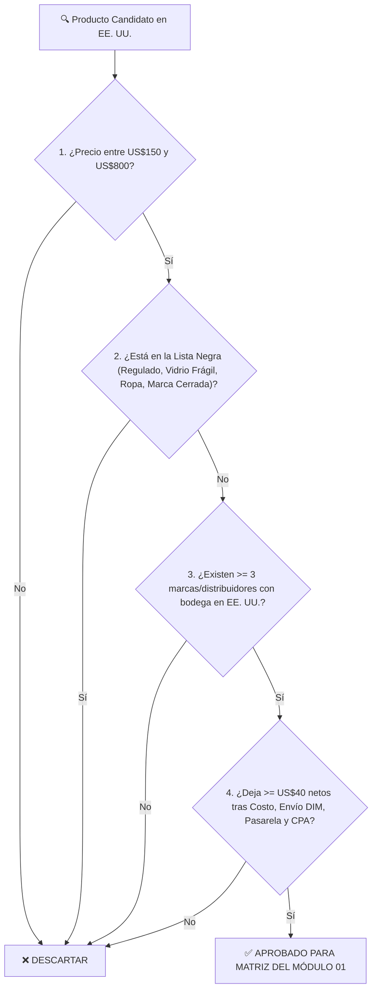

## 🎯 Objetivo de la Lección
Aplicar un sistema objetivo de **10 filtros de selección** y una **Lista Negra de exclusión** para elegir productos entre **US$150 y US$800** que dejen **US$40 o más de ganancia neta**, tengan baja tasa de devolución y se beneficien directamente de tu atención telefónica y por WhatsApp.

---

## 📖 Explicación Sencilla

El éxito o fracaso de tu tienda se decide en un 70% al elegir qué productos vendes. Si eliges un producto de US$250 que es muy frágil (como un espejo de cuerpo entero sin marco reforzado) o que depende del gusto subjetivo y la talla (como botas de cuero), las devoluciones y roturas se comerán toda tu ganancia.

Por el contrario, los mejores productos para un catálogo corto de **3 a 10 artículos** cumplen tres características:
1. **Son funcionales o semi-profesionales (*Prosumer / Light Commercial*):** Resuelven una necesidad concreta en el hogar, patio, taller, oficina o pequeño negocio (ej. equipamiento para *food trucks* o restaurantes, herramientas de garaje, climatización de exteriores, energía de respaldo, mobiliario ergonómico).
2. **Tienen especificaciones técnicas objetivas:** Un cliente necesita confirmar si el equipo es de 110V o 220V, cuántos pies cuadrados cubre o qué accesorios incluye. Ahí es donde **tu llamada telefónica o respuesta por WhatsApp cierra la venta**.
3. **Respetan los 10 Filtros de Oro y están fuera de la Lista Negra.**

### Recurso Visual 1: Árbol de Decisión "Go / No-Go" en 5 Minutos



---

### Recurso Visual 2: Comparativa de Tasa de Devolución y Margen Neto por Tipo de Categoría

```chart
{
  "type": "bar",
  "title": "Tasa de Devolución Promedio (%) vs. Ganancia Neta por Orden (US$) según Categoría",
  "data": {
    "labels": [
      "Moda / Calzado (Lista Negra)",
      "Espejos / Cristal Frágil (Lista Negra)",
      "Equipamiento Patio / Exterior (Aprobado)",
      "Equipos Comerciales Ligeros / Taller (Aprobado)"
    ],
    "datasets": [
      {
        "label": "Tasa de Devolución / Daño (%)",
        "data": [24, 18, 3.2, 2.5],
        "backgroundColor": "#EF4444"
      },
      {
        "label": "Ganancia Neta Real por Pedido (US$)",
        "data": [12, -15, 68, 92],
        "backgroundColor": "#10B981"
      }
    ]
  }
}
```

> [!DATO_CLAVE]
> **La Lista Negra Absoluta (Productos que JAMÁS debes vender):**
> 1. **Productos regulados por agencias federales (FDA / ATF / EPA):** Suplementos alimenticios, equipos médicos invasivos, cosméticos, armas o accesorios tácticos, pesticidas, cigarrillos electrónicos (*vapes*) o CBD. *(Causan cierre inmediato de Shopify Payments y Google Ads).*
> 2. **Artículos de alta fragilidad sin empaque industrial:** Mesas de vidrio templado delgado, jarrones de cerámica, candelabros de cristal suelto o espejos grandes.
> 3. **Productos con talla o ajuste subjetivo:** Ropa, calzado, cascos, anillos o colchones sin política de prueba del fabricante.
> 4. **Marcas que prohíben la reventa en internet (*Brand Gating / Exclusive DTC*):** Grandes marcas de consumo masivo (Apple, Sony, Dyson, Nike, Weber) o marcas que solo venden en su propia web.

> [!EJEMPLO_NUMEROS]
> **Ejemplo con números (Por qué una categoría técnica supera a una decorativa frágil):**
> *(Supuestos: 20 ventas en el mes de un producto de US$400 con US$75 de margen antes de devoluciones)*:
> * **Producto A (Espejo decorativo de vidrio de US$400):** De 20 envíos, 3 llegan estrellados en el camión de FedEx (`15%` de siniestralidad). Aunque reclames al seguro, pierdes el envío y la reposición (`3 x US$280 = -US$840`), borrando más de la mitad de tus ganancias del mes.
> * **Producto B (Calentador radiante de acero inoxidable o Mesa de preparación comercial NSF de US$400):** Construido en acero calibre 18; tasa de daño o devolución menor al `2.5%` (0 o 1 caso cada 40 pedidos). Tus **US$75 por orden** se conservan limpios en tu cuenta.

> [!ANGLO_VS_HISPANO]
> **Mercado Anglo vs. Hispano: Categorías con Fuerte Tracción Bilingüe en EE. UU.:**
> Existen nichos donde tanto compradores anglos como hispanos en EE. UU. invierten activamente tickets de **US$200 a US$800**:
> * **Equipamiento para pequeños negocios de comida, cafeterías y *food trucks*:** Mesas de acero inoxidable certificadas *NSF*, vitrinas térmicas, cortadoras comerciales, licuadoras industriales silenciosas. (Muchos emprendedores hispanos y anglos en TX, CA, FL, NY e IL buscan estos equipos y valoran enormemente hablar por teléfono en su idioma antes de comprar).
> * **Mejoras del hogar, patio y jardín (*Outdoor Living & Patio*):** Pérgolas modulares, calentadores de patio, cocinas exteriores compactas, generadores portátiles *inverter* para temporada de huracanes o cortes eléctricos.
> * **Equipamiento de taller, garaje y contratistas (*Prosumer Garage & Tools*):** Gabinetes de herramientas de acero, compresores silenciosos, organizadores modulares de carga pesada.

---

## 🛠️ Ejercicio Práctico Aplicado a tu Negocio
Abre la plantilla descargable **`m01-matriz-validacion-nichos-productos.csv`** (en Excel o Google Sheets) y anota **3 nichos candidatos** que te resulten interesantes de explicar por teléfono y que cumplan el 100% de los filtros de esta lección.

---

## ✅ Checklist de la Lección
- [ ] Revisé la Lista Negra y descarté cualquier producto regulado, frágil o de moda/tallas.
- [ ] Elegí categorías donde una conversación telefónica o por WhatsApp de 3 minutos aporta valor real al comprador.
- [ ] Anoté mis primeros 3 nichos candidatos en la matriz del Módulo 01.

---

## 🧠 Mini Quiz de Comprobación

```quiz
[
  {
    "pregunta": "1. ¿Cuál de los siguientes productos pasa correctamente los 10 Filtros de Oro para nuestro catálogo high-ticket en EE. UU.?",
    "opciones": [
      "Un dron marca DJI de US$600 comprado en una tienda minorista.",
      "Una mesa de trabajo de acero inoxidable con certificación NSF de US$360 fabricada por un distribuidor mayorista en EE. UU. que acepta Authorized Dealers.",
      "Un espejo de pared de cristal biselado sin marco de US$280.",
      "Un suplemento vitamínico antiedad de US$160."
    ],
    "correcta": 1,
    "explicacion": "La mesa de acero inoxidable de US$360 no es frágil, no está regulada por la FDA como suplemento, no es una marca cerrada como DJI y tiene alta demanda tanto en el mercado anglo como en el hispano."
  },
  {
    "pregunta": "2. ¿Por qué descartamos ropa y calzado aunque cuesten más de US$200?",
    "opciones": [
      "Porque las tasas de devolución por talla y ajuste en ecommerce superan el 20%-30%, destruyendo la economía unitaria y generando costos constantes de envío de retorno.",
      "Porque no se pueden fotografiar.",
      "Porque no existen proveedores en EE. UU.",
      "Porque nadie compra ropa por internet."
    ],
    "correcta": 0,
    "explicacion": "En dropshipping de alto valor buscamos tasas de devolución inferiores al 3%-4% basadas en especificaciones técnicas objetivas, no en tallas subjetivas."
  },
  {
    "pregunta": "3. Verdadero o Falso: Es buena idea vender productos de marcas famosas como Apple, Nike o Dyson sin contrato de distribuidor porque la gente ya las conoce.",
    "opciones": [
      "Verdadero: se venden solos sin esfuerzo.",
      "Falso: vender marcas registradas sin autorización escrita (Authorized Dealer) viola políticas de propiedad intelectual y provoca el cierre inmediato de tu tienda y la retención de tus fondos."
    ],
    "correcta": 1,
    "explicacion": "Siempre trabajaremos únicamente con marcas y fabricantes que aprueben nuestra cuenta como distribuidores autorizados."
  }
]
```

---

## 🎯 Entregable de la Lección
Define tus **3 nichos candidatos** en las primeras filas de tu plantilla **`m01-matriz-validacion-nichos-productos.csv`**.
