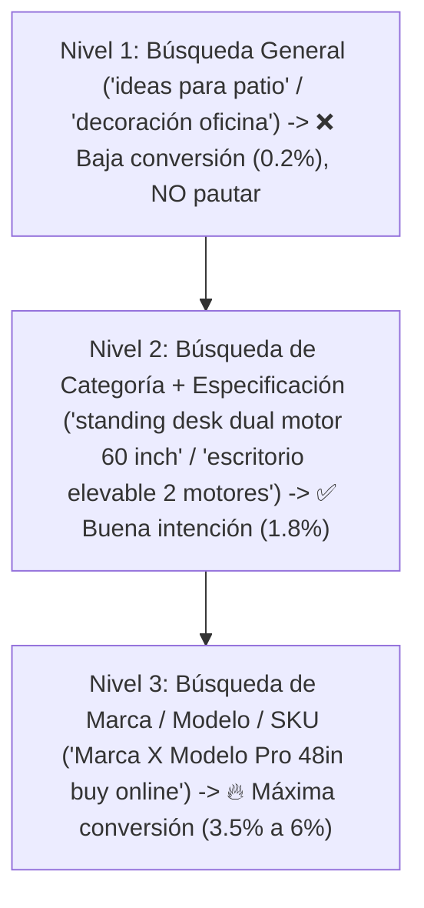

## 🎯 Objetivo de la Lección
Distinguir entre búsquedas informativas (curiosos) y **búsquedas transaccionales de alta intención de compra (*high-intent commercial queries*)** en inglés y español dentro de Estados Unidos, utilizando herramientas gratuitas (Google Shopping, Google Trends, Google Keyword Planner y autocompletado).

---

## 📖 Explicación Sencilla

En el modelo de alto valor **no intentamos "crear demanda"** interrumpiendo a adolescentes en redes sociales. En cambio, **capturamos demanda existente**: personas en Estados Unidos que hoy mismo están escribiendo en Google el nombre exacto del producto, sus medidas o la marca porque ya tienen la tarjeta en la mano para comprarlo.

Para validar que un producto de **US$150 a US$800** tiene demanda saludable en EE. UU., verificamos tres niveles de búsqueda:
1. **Búsqueda de categoría específica:** ej. *"commercial patio heater propane"* / *"calentador de patio para restaurante"*.
2. **Búsqueda de especificación o problema:** ej. *"48 inch stainless steel prep table NSF"* / *"mesa de acero inoxidable 48 pulgadas"*.
3. **Búsqueda de marca y modelo (*SKU / Brand Search*):** cuando el comprador ya eligió la marca de tu proveedor y compara dónde comprarlo con mejor atención y envío rápido.

### Recurso Visual 1: Embudo de Intención de Búsqueda (Por dónde empezar a vender)



---

### Recurso Visual 2: Tasa de Conversión y Costo por Clic según la Intención de la Palabra Clave

```chart
{
  "type": "bar",
  "title": "Rendimiento en EE. UU. según el Tipo de Búsqueda e Idioma",
  "data": {
    "labels": [
      "Genérica en Inglés",
      "Específica/SKU en Inglés",
      "Específica en Español (EE. UU.)",
      "Búsqueda + Consulta WhatsApp/Teléfono"
    ],
    "datasets": [
      {
        "label": "Tasa de Conversión Estimada (%)",
        "data": [0.4, 2.2, 2.6, 18.5],
        "backgroundColor": "#7C3AED"
      },
      {
        "label": "Costo por Clic Promedio CPC (US$)",
        "data": [2.1, 1.45, 0.85, 1.15],
        "backgroundColor": "#38BDF8"
      }
    ]
  }
}
```

> [!EJEMPLO_NUMEROS]
> **Ejemplo con números (El arbitraje bilingüe en EE. UU.):**
> *(Supuestos basados en promedios de subasta de Google Ads en EE. UU. para equipamiento comercial ligero de US$420)*:
> * En **inglés**, el término `"commercial meat slicer 10 inch"` tiene **3,600 búsquedas/mes** en EE. UU. con un CPC promedio de **US$1.60**. Con una conversión del `2.0%`, necesitas 50 clics (`50 x US$1.60 = US$80` de CPA) para lograr 1 venta.
> * En **español dentro de EE. UU.**, términos como `"cortadora de carnes frias comercial"` o `"rebanadora comercial 10 pulgadas"` suman **750 búsquedas/mes** en estados como TX, CA, FL, IL y NY, pero como casi ningún competidor configura campañas ni páginas en español, el CPC suele ser un **30% a 45% más económico (`~US$0.95 por clic`)**. Con 40 clics y apoyo por WhatsApp/teléfono, logras 1 venta con un **CPA de apenas US$38**, aumentando tu ganancia neta por pedido en **+US$42 adicionales**.

> [!ANGLO_VS_HISPANO]
> **Mercado Anglo vs. Hispano: El fenómeno de la "Búsqueda Híbrida" (*Code-Switching*):**
> Muchos compradores hispanos bilingües en EE. UU. buscan el nombre técnico del producto en **inglés** (porque así aparece en manuales o normas de EE. UU., ej. *"NSF prep table"* o *"portable power station"*), pero cuando entran a la tienda y ven el botón **"Atención en Español por Teléfono / WhatsApp"**, prefieren hacer sus preguntas finales en español. Por eso tu tienda tendrá ambos idiomas conectados a un clic de distancia.

> [!ERROR_COMUN]
> **Usar Google Trends sin filtrar por país ("Estados Unidos") ni evaluar estacionalidad extrema:** Si eliges un producto que solo se busca durante 3 semanas en diciembre o solo en julio, tu negocio pasará 10 meses sin ventas. Busca productos con **demanda constante todo el año (*evergreen demand*)** o combina en tus 3 a 10 productos artículos que equilibren el calendario.

---

## 🛠️ Ejercicio Práctico Aplicado a tu Negocio
1. Entra a **Google Shopping (configurado en ubicación EE. UU.)** y a **Google Trends (ubicado en United States)**.
2. Busca tus 3 nichos candidatos en inglés y en español.
3. Verifica que existan al menos **5 a 10 tiendas especializadas** (no solo Amazon, Walmart o Home Depot) anunciando productos de **US$150 a US$800** en la pestaña de Google Shopping: si otras tiendas especializadas pagan anuncios ahí mes tras mes, es prueba real de que el nicho es rentable.

---

## ✅ Checklist de la Lección
- [ ] Comprobé mis 3 nichos en Google Trends (EE. UU. - últimos 5 años) para confirmar que no están en declive ni dependen de un solo mes al año.
- [ ] Revisé Google Shopping EE. UU. y confirmé que existen tiendas especializadas vendiendo entre US$150 y US$800.
- [ ] Anoté los términos de búsqueda reales en inglés y en español que usan los compradores.

---

## 🧠 Mini Quiz de Comprobación

```quiz
[
  {
    "pregunta": "1. ¿Cuál de las siguientes búsquedas en Google tiene la MAYOR intención de compra inmediata para un producto high-ticket?",
    "opciones": [
      "'cómo decorar un jardín pequeño'",
      "'fotos de oficinas modernas'",
      "'comprar calentador de patio infrarrojo 4000W acero inoxidable envío EE. UU.'",
      "'historia de la energía solar'"
    ],
    "correcta": 2,
    "explicacion": "Las búsquedas que incluyen especificaciones técnicas (4000W, acero inoxidable) y modificadores comerciales (comprar, envío) provienen de usuarios listos para adquirir el producto."
  },
  {
    "pregunta": "2. ¿Qué significa si al buscar un producto en Google Shopping EE. UU. ves que SOLO aparecen Amazon, Walmart y Home Depot a precios bajísimos y ninguna tienda especializada?",
    "opciones": [
      "Que es una oportunidad perfecta para competir por precio.",
      "Que es una categoría dominada por gigantes minoristas con márgenes mínimos; debemos buscar subcategorías o marcas especializadas donde operen distribuidores autorizados (Authorized Dealers).",
      "Que Google Shopping está roto.",
      "Que debemos venderlo a mitad de precio."
    ],
    "correcta": 1,
    "explicacion": "Nunca compitas en guerra de precios contra marcas propias de Amazon o grandes superficies; busca nichos donde existan tiendas de distribuidores autorizados con precios protegidos por MAP."
  },
  {
    "pregunta": "3. ¿Por qué muchos compradores hispanos en EE. UU. realizan búsquedas técnicas en inglés pero cierran la compra en español?",
    "opciones": [
      "Porque sus teléfonos no tienen la letra ñ.",
      "Por el comportamiento bilingüe (code-switching): conocen el término técnico en inglés en su trabajo o industria, pero sienten mayor confianza al aclarar dudas de garantía, envío y pago en su idioma materno.",
      "Porque está prohibido buscar en español en EE. UU.",
      "Porque los productos cambian de tamaño según el idioma."
    ],
    "correcta": 1,
    "explicacion": "Ofrecer fichas técnicas claras en ambos idiomas y atención humana en español e inglés captura a este valioso comprador bicultural."
  }
]
```

---

## 🎯 Entregable de la Lección
Completa las columnas de **Búsquedas Mensuales EN/ES** y **Precio de Mercado en Google Shopping** en tu archivo **`m01-matriz-validacion-nichos-productos.csv`**.
