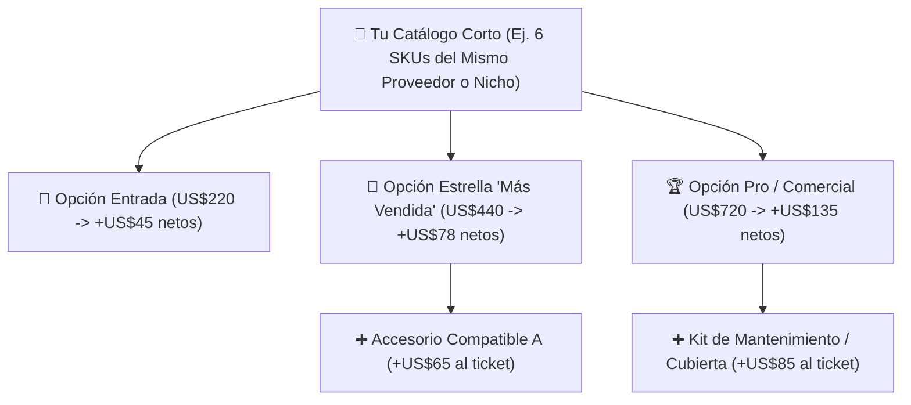

## 🎯 Objetivo de la Lección
Estructurar tu catálogo corto de **3 a 10 productos (*SKUs*)** de forma estratégica para que tus propios productos se ayuden a vender entre sí, facilitando que tú guíes al cliente por teléfono o WhatsApp hacia la opción ideal sin que abandone tu tienda.

---

## 📖 Explicación Sencilla

Cuando un comprador entra a una tienda que tiene **un solo producto** de US$420, su cerebro hace una pregunta binaria: *"¿Lo compro o me voy?"* (y el 98% se va).
En cambio, cuando estructuras un **catálogo corto de 5 a 8 productos bien pensados dentro de la misma solución**, el cerebro del comprador cambia la pregunta a: *"¿Cuál de estos 3 modelos me conviene más?"*.

Así es como los mejores distribuidores estructuran un catálogo de **3 a 10 productos**:
1. **Nivel Entrada (*Good* — US$150 a US$280):** El modelo compacto o residencial para quien tiene presupuesto ajustado (Ganancia neta objetivo: **US$40 a US$55**).
2. **Nivel Estrella (*Better* — US$300 a US$520):** El modelo con mejor relación calidad-precio; aquí se concentrará el **60% de tus ventas** (Ganancia neta objetivo: **US$65 a US$95**).
3. **Nivel Profesional (*Best* — US$550 a US$800):** El modelo de mayor capacidad o servicio pesado (*heavy-duty*) para clientes exigentes o pequeños negocios (Ganancia neta objetivo: **US$100 a US$160**).
4. **Complementos de Alto Margen (*Add-ons*):** Cubiertas protectoras, kits de instalación o accesorios compatibles que el cliente agrega al carrito y que se envían desde el mismo proveedor.

### Recurso Visual 1: Mapa de Ecosistema para un Catálogo de 6 Productos



---

### Recurso Visual 2: Efecto de la Escalera de Valor en tu Ganancia Neta por Pedido

```chart
{
  "type": "bar",
  "title": "Precio de Venta vs. Ganancia Neta Libre por Pedido en tu Escalera de Catálogo (US$)",
  "data": {
    "labels": [
      "Modelo Entrada (US$220)",
      "Modelo Estrella (US$440)",
      "Modelo Estrella + Accesorio (US$515)",
      "Modelo Pro Comercial (US$720)"
    ],
    "datasets": [
      {
        "label": "Precio de Venta (US$)",
        "data": [220, 440, 515, 720],
        "backgroundColor": "#94A3B8"
      },
      {
        "label": "Ganancia Neta Libre después de Costos y Ads (US$)",
        "data": [45, 78, 106, 135],
        "backgroundColor": "#10B981"
      }
    ]
  }
}
```

> [!EJEMPLO_NUMEROS]
> **Ejemplo con números (Cómo tu asesoría telefónica sube el ticket promedio):**
> Imagina que un cliente hispano o anglo entra a tu tienda atraído por el **Modelo de Entrada de US$220** (que te deja **US$45 netos**). Te escribe por WhatsApp o llama para preguntar: *"¿Este modelo de US$220 me sirve para usarlo 6 horas seguidas todos los días en mi taller?"*.
> Con honestidad consultiva le respondes: *"Si lo vas a usar 6 horas diarias, el de US$220 se te va a quedar corto porque es residencial. Te recomiendo el Modelo Estrella de US$440 que tiene motor continuo y 2 años de garantía comercial"*.
> El cliente agradece tu honestidad, compra el de **US$440** y tu ganancia neta en esa sola llamada sube de **US$45 a US$78 (+73% más de ganancia con el mismo clic publicitario)**.

> [!ANGLO_VS_HISPANO]
> **Mercado Anglo vs. Hispano: Cómo presentar las opciones en la tienda:**
> * **Para el comprador Anglo:** Incluye en cada página de producto una tabla comparativa visual (*"Compare Our Models"*) donde vea de un vistazo las diferencias de capacidad, dimensiones y garantía entre tus 3 o 5 modelos sin tener que abrir 5 pestañas.
> * **Para el comprador Hispano:** Añade debajo de la tabla un botón directo: **"¿No estás seguro de qué capacidad necesitas? Háblanos por WhatsApp o llámanos y te ayudamos a elegir el modelo exacto en 2 minutos"**.

> [!ERROR_COMUN]
> **Ofrecer productos complementarios de proveedores distintos sin avisar:** Si un cliente compra el Producto Principal (Proveedor A en Texas) más un Accesorio pequeño (Proveedor B en Ohio), si no calculaste dos envíos separados, el costo de envío del accesorio se comerá su margen. **Regla:** Los accesorios complementarios deben ser de la **misma marca/proveedor** que el producto principal para que viajen en el mismo despacho.

---

## 🛠️ Ejercicio Práctico Aplicado a tu Negocio
Dentro de tu nicho favorito en la plantilla **`m01-matriz-validacion-nichos-productos.csv`**, selecciona productos que cubran los tres escalones de precio:
* Al menos 2 productos entre **US$150 y US$299**.
* Al menos 4 productos entre **US$300 y US$549**.
* Al menos 2 productos entre **US$550 y US$800**.

---

## ✅ Checklist de la Lección
- [ ] Diseñé mi selección preliminar aplicando la estructura "Entrada / Estrella / Profesional".
- [ ] Verifiqué que los accesorios o complementos pertenezcan a las mismas marcas que los productos principales.
- [ ] Comprobé cómo explicar en 30 segundos por qué un cliente debería subir del modelo básico al modelo estrella según su uso.

---

## 🧠 Mini Quiz de Comprobación

```quiz
[
  {
    "pregunta": "1. ¿Por qué estructuramos nuestro catálogo corto en tres niveles de precio (Entrada US$150-280, Estrella US$300-520, Pro US$550-800)?",
    "opciones": [
      "Para confundir al comprador.",
      "Para que el visitante compare opciones dentro de nuestra propia tienda y podamos guiarlo consultivamente hacia el modelo que mejor resuelve su necesidad y maximiza nuestro margen neto.",
      "Porque los proveedores prohíben tener un solo precio.",
      "Para llenar espacio en la pantalla."
    ],
    "correcta": 1,
    "explicacion": "La arquitectura 'Good / Better / Best' ancla el valor, evita que el usuario salga a comparar afuera y permite hacer upselling honesto por teléfono o WhatsApp."
  },
  {
    "pregunta": "2. ¿Cuál es la regla obligatoria al ofrecer un accesorio complementario (add-on) junto a un producto principal?",
    "opciones": [
      "Debe venir de un proveedor distinto en otro país.",
      "Debe pertenecer al mismo proveedor/bodega del producto principal para despacharse junto y no pagar doble flete base.",
      "Debe ser más caro que el producto principal.",
      "Debe enviarse sin número de rastreo."
    ],
    "correcta": 1,
    "explicacion": "Si el accesorio sale de la misma bodega del proveedor principal, se consolida el envío y el margen del accesorio se convierte casi íntegro en ganancia neta adicional."
  },
  {
    "pregunta": "3. Si un cliente te llama preguntando por un equipo básico de US$190 para darle uso rudo comercial y tú sabes que ese modelo es solo doméstico, ¿qué debes hacer?",
    "opciones": [
      "Decirle que sí le sirve para vender rápido aunque luego lo devuelva.",
      "Asesorarlo con total honestidad: explicarle que para uso comercial necesita el modelo de US$390 con garantía comercial, evitando una devolución segura y aumentando tu ganancia neta.",
      "Cortar la llamada.",
      "Bajarle el precio a US$100."
    ],
    "correcta": 1,
    "explicacion": "La venta consultiva ética previene devoluciones costosas, fideliza al cliente y eleva tu ganancia por orden."
  }
]
```

---

## 🎯 Entregable de la Lección
Clasifica tus productos candidatos por escalón (**Entrada, Estrella, Pro**) dentro de **`m01-matriz-validacion-nichos-productos.csv`**.
