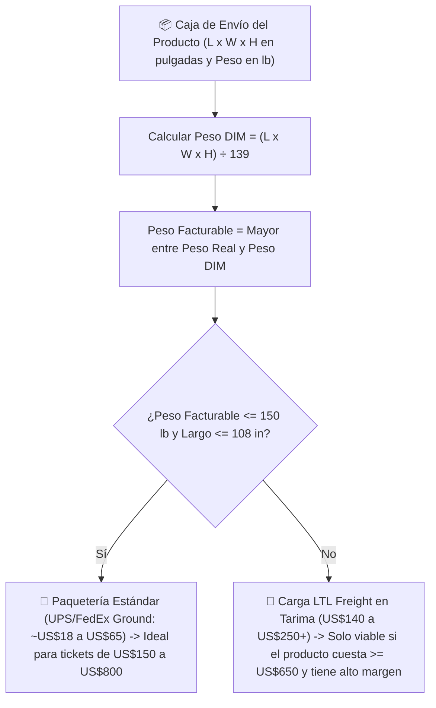

## 🎯 Objetivo de la Lección
Aprender a calcular en 60 segundos el **Peso Volumétrico (*Dimensional Weight / DIM Weight*)** y distinguir entre envíos de paquetería estándar (*Parcel: UPS/FedEx Ground*) y carga en tarima (*LTL Freight*) en Estados Unidos, asegurando que el envío nunca destruya tu ganancia neta mínima de **US$40 por pedido**.

---

## 📖 Explicación Sencilla

Este es el secreto operativo que separa a los novatos que pierden dinero en su primera venta de los operadores profesionales de *high-ticket*:

Cuando envías una caja por **UPS o FedEx dentro de EE. UU.**, la empresa de transporte **NO te cobra solo por lo que pesa la caja en la báscula**. Te cobra por el **espacio que ocupa en el camión**, usando el **Peso Volumétrico (*Dimensional Weight*)**.

La fórmula estándar comercial de UPS y FedEx en EE. UU. (en pulgadas y libras) es:
1. Multiplicas **Largo (in) × Ancho (in) × Alto (in)** de la caja de envío.
2. Divides ese resultado entre el divisor estándar de **139**.
3. **El transportista te cobra el que sea MAYOR:** el Peso Físico real o el Peso Dimensional.

Además, existen dos mundos de envío en EE. UU.:
* **Paquetería Estándar (*Parcel — UPS Ground / FedEx Home Delivery*):** Cajas de hasta **150 lb** y hasta **108 pulgadas de largo** (o 165 pulgadas combinando largo + circunferencia). Costo típico: **US$18 a US$65**.
* **Carga Pesada (*LTL Freight — Less-Than-Truckload*):** Cuando la caja supera las 150 lb o las dimensiones máximas de paquetería, viaja en camión sobre una tarima (*pallet*). El costo mínimo de un envío *LTL Freight* residencial en EE. UU. rara vez baja de **US$140 a US$250**. Por lo tanto, **nunca vendas un producto que requiera LTL Freight si cuesta menos de US$600**, porque el flete absorberá todo tu margen.

### Recurso Visual 1: Flujo de Clasificación de Envío en EE. UU. (Parcel vs. LTL Freight)



---

### Recurso Visual 2: Cómo el Peso Dimensional Afecta tu Ganancia Neta Real

Mira este ejemplo real de tres productos que se venden exactamente al mismo precio (**US$320**) y tienen el mismo costo de fábrica (**US$180**), pero cajas de distinto tamaño:

```chart
{
  "type": "bar",
  "title": "Impacto del Tamaño de la Caja en la Ganancia Neta de un Producto de US$320",
  "data": {
    "labels": [
      "Producto Compacto (Caja 18x14x12 in = 22 lb DIM)",
      "Producto Mediano (Caja 32x20x18 in = 83 lb DIM)",
      "Producto Voluminoso No Desarmable (Caja 48x30x28 in = 290 lb DIM)"
    ],
    "datasets": [
      {
        "label": "Costo de Envío en EE. UU. (US$)",
        "data": [24, 52, 165],
        "backgroundColor": "#EF4444"
      },
      {
        "label": "Ganancia Neta Final del Pedido (US$)",
        "data": [62, 34, -79],
        "backgroundColor": "#10B981"
      }
    ]
  }
}
```

> [!EJEMPLO_NUMEROS]
> **Ejemplo con números reales (La trampa del sillón o gabinete armado de US$320):**
> Supongamos que encuentras un sillón de exterior de ratán sintético que se vende en **US$320** y cuesta **US$180** en el proveedor. Pesa solo **28 libras** en la báscula, pero viene armado en una caja rígida de **48 × 30 × 28 pulgadas**:
> * **Volumen cúbico:** `48 x 30 x 28 = 40,320 pulgadas cúbicas`.
> * **Peso Dimensional:** `40,320 ÷ 139 = 290.1 libras facturables` (supera el límite de 150 lb de UPS Ground y pasa a recargo de *Oversize / LTL Freight* de **~US$165**).
> * **Resultado financiero:** `US$320 (Precio) - US$180 (Costo) - US$165 (Envío) - US$9.58 (Pasarela) - US$45 (Publicidad) = -US$79.58 de PÉRDIDA neta`.
> * **La alternativa inteligente (*Flat-Pack / Knock-Down*):** Si en cambio eliges un producto que viene **desarmado en caja plana (*flat-pack*)** de **36 × 18 × 10 pulgadas** (`6,480 ÷ 139 = 46.6 lb DIM`), el envío cuesta **~US$32**, dejándote **+US$53.42 de ganancia neta limpia**.

> [!ANGLO_VS_HISPANO]
> **Mercado Anglo vs. Hispano: Claridad en la Entrega Residencial:**
> * En los **48 estados contiguos (*Lower 48*)**, tanto clientes anglos como hispanos esperan **Envío Gratis (*Free Shipping*)** incluido dentro del precio publicado en productos de US$150 a US$800.
> * Por eso en tu tienda **siempre incluirás el costo de envío dentro del precio de venta final** y anunciarás con claridad: *"Free Ground Shipping to the Contiguous 48 U.S. States"* / *"Envío Gratis a domicilio en los 48 estados contiguos de EE. UU."* (excluyendo Alaska, Hawái y Puerto Rico del envío gratuito automático para proteger tu margen).

> [!DATO_CLAVE]
> **Dónde ver las dimensiones de la caja antes de hablar con el proveedor:**
> Busca el modelo candidato en Amazon, Wayfair o Home Depot y baja hasta la sección **"Specifications / Shipping Dimensions / Package Weight"**. Ahí verás el largo, ancho y alto exacto de la caja en pulgadas para meterlo en tu matriz antes de enamorarte del producto.

---

## 🛠️ Ejercicio Práctico Aplicado a tu Negocio
1. Completa las columnas de **Dimensiones de Caja (`L x W x H`)** y **Peso Dimensional (`L*W*H/139`)** para tus productos candidatos en **`m01-matriz-validacion-nichos-productos.csv`**.
2. Usa la **Calculadora Interactiva de Economía Unitaria** del portal para verificar que cada uno de tus productos preseleccionados deje **US$40 o más de ganancia neta** después de restar su envío real.

---

## ✅ Checklist de la Lección
- [ ] Sé calcular el Peso Volumétrico `(Largo x Ancho x Alto) ÷ 139` en pulgadas.
- [ ] Verifiqué que mis productos de entre US$150 y US$550 viajen por paquetería estándar (*Parcel <= 150 lb*, idealmente en empaque plano o compacto).
- [ ] Confirmé que solo venderé con envío incluido en los **48 estados contiguos de EE. UU.** para evitar sobrecostos aéreos/marítimos.
- [ ] Tengo al menos 10 productos aprobados en mi archivo `m01-matriz-validacion-nichos-productos.csv`.

---

## 🧠 Mini Quiz de Comprobación

```quiz
[
  {
    "pregunta": "1. Una caja mide 30 pulgadas de largo, 20 pulgadas de ancho y 20 pulgadas de alto, y pesa 35 libras en la báscula. Usando el divisor estándar 139 de UPS/FedEx, ¿cuál es su Peso Dimensional y qué peso te cobrará el transportista?",
    "opciones": [
      "Peso Dimensional de 35 lb; te cobran 35 lb.",
      "Peso Dimensional de 86.3 lb (12,000 ÷ 139); el transportista te cobrará sobre 87 lb porque el Peso Dimensional es mayor que el peso físico.",
      "Peso Dimensional de 10 lb; te cobran 10 lb.",
      "El tamaño de la caja no importa en EE. UU."
    ],
    "correcta": 1,
    "explicacion": "30 x 20 x 20 = 12,000 pulgadas cúbicas. 12,000 ÷ 139 = 86.33 lb (se redondea hacia arriba a 87 lb). Como 87 lb > 35 lb de báscula, pagarás la tarifa de 87 lb."
  },
  {
    "pregunta": "2. ¿Por qué preferimos productos que se envían en empaque plano o compacto (flat-pack) en el rango de US$150 a US$500?",
    "opciones": [
      "Porque pesan más.",
      "Porque reducen drásticamente el Peso Dimensional, mantienen el envío dentro de tarifas económicas de UPS/FedEx Ground (US$20-US$45) y tienen mucho menor riesgo de golpes en tránsito.",
      "Porque no necesitan número de guía.",
      "Porque van en avión."
    ],
    "correcta": 1,
    "explicacion": "Un empaque compacto mantiene bajo el costo de envío doméstico y protege tu margen neto de US$40+ por pedido."
  },
  {
    "pregunta": "3. ¿Por qué nuestra política de 'Envío Gratis' debe especificar que aplica a los 48 estados contiguos de EE. UU. (Contiguous 48 States)?",
    "opciones": [
      "Porque en Alaska, Hawái y Puerto Rico no existen correos.",
      "Porque los envíos de paquetes grandes a Alaska, Hawái y Puerto Rico requieren transporte aéreo o marítimo que puede triplicar el costo del flete y comerse toda la ganancia del pedido.",
      "Porque la ley prohíbe vender fuera de tu estado.",
      "Porque Google no muestra anuncios en otros estados."
    ],
    "correcta": 1,
    "explicacion": "Limitar el envío gratuito automático a los 48 estados contiguos (y cotizar aparte si alguien de AK/HI/PR llama) protege tu economía unitaria de fletes sorpresa."
  }
]
```

---

## 🎯 Entregable de la Lección
Termina de llenar tu matriz **`m01-matriz-validacion-nichos-productos.csv`** con tus **10 a 15 productos aprobados (`GO`)** y marca el **Checkpoint del Módulo 01** para avanzar al **Módulo 02 (Proveedores en EE. UU.)**.
