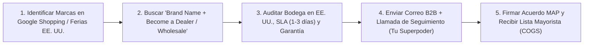

# 📄 Hoja de Referencia Visual (Cheat Sheet) — Módulo 02

## 1. Resumen Ejecutivo del Módulo 02
**Proveedores en EE. UU.: Búsqueda, Verificación, Muestras y Negociación** — *Dónde encontrar distribuidores autorizados con inventario en EE. UU., cómo verificar sus garantías y cómo usar el teléfono para lograr tu aprobación B2B.*

* **Nivel:** Intermedio | **Duración:** 7 horas (3 h estudio + 4 h prospección)
* **Prerrequisitos:** Módulo 01 completado
* **Proyecto de la Semana:** Directorio Propio de 20 Proveedores Verificados en EE. UU.
* **Plantilla Asociada:** `m02-directorio-auditoria-proveedores-usa.csv`

---

## 2. Diagrama Clave de Operación

---

## 3. Reglas de Oro y Lista de Verificación Rápida
* **Ejemplo Numérico Clave:** Un proveedor mayorista en Texas ofrece un margen del **35% bajo el precio MAP** en equipos de US$500 (COGS = US$325). Si envías solo el formulario web, tardan 3 semanas en responder. Si envías el formulario y **llamas 24 horas después al departamento de Dealer Relations**, el 65% revisa tu solicitud ese mismo día.
* **Enfoque Mercado Anglo vs. Hispano:** Muchos distribuidores e importadores industriales ubicados en **Florida, Texas, California y Nueva Jersey** cuentan con gerentes de cuenta bilingües o hispanos. Presentar tu tienda como un canal especializado que atiende tanto al comprador anglo como al mercado hispano de EE. UU. (68 millones de habitantes) es un argumento comercial que les encanta porque les abre ventas donde ellos no tienen soporte en español.
* **Error Crítico a Evitar:** Pagar membresías caras en 'directorios mágicos de dropshipping' llenos de intermediarios que inflan el precio un 20% y te dejan sin margen para competir.
