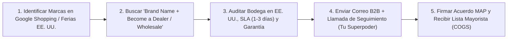

## 🎯 Objetivo de la Lección
Encontrar fabricantes y distribuidores autorizados reales con inventario en EE. UU. usando ingeniería inversa de Google Shopping, directorios B2B y catálogos de ferias. Además, aplicarás los principios de **Proveedores en EE. UU.: Búsqueda, Verificación, Muestras y Negociación** directamente a tu catálogo de **3 a 10 productos de alto valor (US$150 a US$800)** para el mercado anglo e hispano de Estados Unidos.

---

## 📖 Explicación Sencilla
Dónde encontrar distribuidores autorizados con inventario en EE. UU., cómo verificar sus garantías y cómo usar el teléfono para lograr tu aprobación B2B.

Para operar con éxito dentro de tus **12 horas semanales** y proteger tu meta de **US$2,500 de ganancia neta mensual**, este módulo se centra en pasos accionables y medibles:
1. **Encontrar fabricantes y distribuidores autorizados reales con inventario en EE. UU. usando ingeniería inversa de Google Shopping, directorios B2B y catálogos de ferias.**
2. **Auditar tiempos de preparación (handling time <= 3 días), políticas de devolución (RMA) y garantías domésticas.**
3. **Evaluar la calidad mediante pedido de muestras, inspección en video o fichas técnicas certificadas.**
4. **Negociar apertura de cuentas mayoristas usando correo y llamada telefónica en inglés y español.**

### Recurso Visual 1: Flujo Operativo del Módulo 02



---

### Recurso Visual 2: Datos e Impacto en Resultados

```chart
{
  "type": "bar",
  "title": "Tasa de Aprobación de Cuentas con Proveedores en EE. UU. (%)",
  "data": {
    "labels": ["Solo Formulario Web Frío", "Correo Genérico sin Tienda", "Tienda Lista + Correo + Llamada Telefónica"],
    "datasets": [{
      "label": "% de Proveedores que Aprueban tu Cuenta",
      "data": [8, 18, 65],
      "backgroundColor": ["#EF4444", "#F59E0B", "#0891B2"]
    }]
  }
}
```

> [!EJEMPLO_NUMEROS]
> **Ejemplo con números reales aplicados a tu negocio:**
> Un proveedor mayorista en Texas ofrece un margen del **35% bajo el precio MAP** en equipos de US$500 (COGS = US$325). Si envías solo el formulario web, tardan 3 semanas en responder. Si envías el formulario y **llamas 24 horas después al departamento de Dealer Relations**, el 65% revisa tu solicitud ese mismo día.

> [!ANGLO_VS_HISPANO]
> **Mercado Anglo vs. Hispano en EE. UU.:**
> Muchos distribuidores e importadores industriales ubicados en **Florida, Texas, California y Nueva Jersey** cuentan con gerentes de cuenta bilingües o hispanos. Presentar tu tienda como un canal especializado que atiende tanto al comprador anglo como al mercado hispano de EE. UU. (68 millones de habitantes) es un argumento comercial que les encanta porque les abre ventas donde ellos no tienen soporte en español.

> [!ERROR_COMUN]
> **Error común que debes evitar:**
> Pagar membresías caras en 'directorios mágicos de dropshipping' llenos de intermediarios que inflan el precio un 20% y te dejan sin margen para competir.

---

## 🛠️ Ejercicio Práctico Aplicado a tu Negocio
1. Descarga la plantilla **`m02-directorio-auditoria-proveedores-usa.csv`** desde el botón de esta lección o desde la Biblioteca de Plantillas.
2. Completa tu entregable de la semana: **Directorio Propio de 20 Proveedores Verificados en EE. UU.** (Construir una base de datos de 20 marcas o distribuidores mayoristas domésticos en EE. UU., auditando ubicación de bodega, SLA de envío, política RMA y contrato MAP.).

---

## ✅ Checklist de la Lección
- [ ] `Armé mi lista de al menos 15 a 20 proveedores legítimos con bodega física en EE. UU.`
- [ ] `Descarté intermediarios sin inventario propio o con tiempos de envío mayores a 7 días hábiles.`
- [ ] `Tengo listos mis guiones bilingües de contacto (m02-guiones-contacto-proveedores-b2b-en-es.md).`

---

## 🧠 Mini Quiz de Comprobación

```quiz
[
  {
    "pregunta": "1. ¿Cuál es la forma más efectiva y gratuita de encontrar proveedores reales de alto valor en EE. UU.?",
    "opciones": [
      "Buscar en AliExpress con envío de 25 días.",
      "Hacer ingeniería inversa en Google Shopping identificando las marcas especializadas que venden otros distribuidores autorizados y buscar '[Nombre de Marca] wholesale / become a dealer'.",
      "Comprar productos en Walmart y reenviarlos.",
      "Usar proveedores sin dirección física."
    ],
    "correcta": 1,
    "explicacion": "Las marcas reales tienen programas de Authorized Dealer en su propia web corporativa o trabajan con distribuidores regionales en EE. UU."
  },
  {
    "pregunta": "2. ¿Qué es la política MAP (Minimum Advertised Price) de un proveedor?",
    "opciones": [
      "Un mapa de las carreteras de EE. UU.",
      "El precio mínimo oficial por debajo del cual ningún distribuidor autorizado puede anunciar el producto, protegiendo tu margen de ganancia contra guerras de precios.",
      "Un impuesto adicional de aduana.",
      "El costo del envío por avión."
    ],
    "correcta": 1,
    "explicacion": "Trabajar con proveedores que hacen cumplir su política MAP protege tu ganancia neta de US$40+ por pedido."
  },
  {
    "pregunta": "3. ¿Cómo puedes verificar la calidad de un producto de US$500 si no puedes pedir muestras físicas de los 10 productos a la vez?",
    "opciones": [
      "Adivinando por una foto borrosa.",
      "Solicitando al proveedor videos de inspección de empaque, certificados de calidad (UL/ETL/NSF), manuales de usuario en PDF, auditando reseñas verificadas de la marca en EE. UU. y pidiendo muestra del SKU más vendido.",
      "No verificando nada.",
      "Esperando a que el primer cliente se queje."
    ],
    "correcta": 1,
    "explicacion": "Combinar auditoría documental (certificaciones, manuales, reseñas de la marca en EE. UU.), solicitud de fotos/video de empaque en bodega y muestras selectivas te da certeza real."
  }
]
```

---

## 🎯 Entregable de la Lección
Completa tu archivo **`m02-directorio-auditoria-proveedores-usa.csv`** y marca los criterios del **Checkpoint del Módulo 02** cuando estés listo/a para avanzar.
