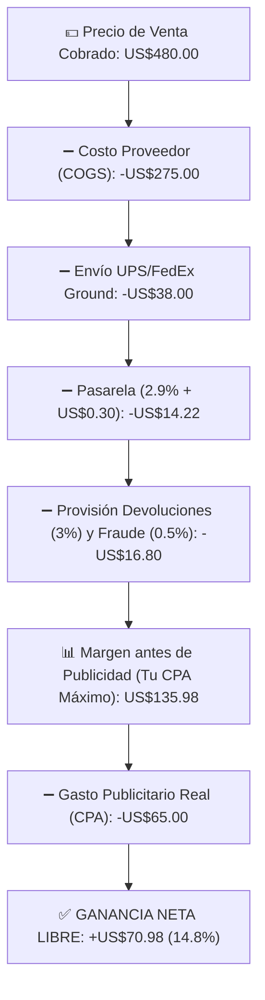

# 📄 Hoja de Referencia Visual (Cheat Sheet) — Módulo 03

## 1. Resumen Ejecutivo del Módulo 03
**Economía Unitaria: Precio, Costo, Envío, CPA, Devoluciones y Punto de Equilibrio** — *Domina cada centavo de tu negocio: cómo calcular tu margen neto real, tu CPA máximo, tu ROAS de equilibrio y el flujo de caja.*

* **Nivel:** Intermedio | **Duración:** 6 horas (3 h estudio + 3 h modelado financiero)
* **Prerrequisitos:** Módulos 00 y 01 completados
* **Proyecto de la Semana:** Modelado Financiero de tus 10 Productos Candidatos
* **Plantilla Asociada:** `m03-modelo-maestro-economia-unitaria.csv`

---

## 2. Diagrama Clave de Operación

---

## 3. Reglas de Oro y Lista de Verificación Rápida
* **Ejemplo Numérico Clave:** En un producto de **US$480**, tras restar US$275 de costo, US$38 de envío, US$14.22 de pasarela y US$16.80 de reserva para devoluciones/contracargos, tu **Margen antes de Publicidad es de US$135.98**. Eso significa que tu **CPA Máximo (Break-Even CPA) es US$135.98** y tu **ROAS de Equilibrio es `480 ÷ 135.98 = 3.53x`**. Si tu campaña logra un CPA de US$65 (ROAS `7.38x`), te quedan **US$70.98 netos limpios** en el bolsillo.
* **Enfoque Mercado Anglo vs. Hispano:** Al calcular comisiones de pasarela, recuerda que **el uso de pago en cuotas (BNPL: Affirm / Shop Pay Installments / Klarna)** es muy popular tanto en compradores hispanos jóvenes como en anglos para compras mayores a US$300. Las comisiones BNPL suelen rondar el **5.5% al 5.9% + US$0.30** (frente al 2.9% de tarjeta normal). Asegúrate de que tu margen soporte ese 3% adicional en los pedidos financiados.
* **Error Crítico a Evitar:** No incluir una provisión estadística del **2.5% al 3.5% para devoluciones y contracargos** en cada pedido. Aunque en 10 pedidos no tengas ninguna devolución, en el pedido 15 ocurrirá una y la provisión acumulada la pagará sin tocar tu ganancia.
