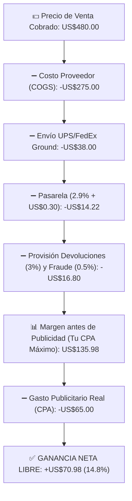

## 🎯 Objetivo de la Lección
Desglosar todos los costos directos e indirectos de un pedido: COGS, envío dimensional, comisión de pasarela/BNPL, CPA, devoluciones y contracargos. Además, aplicarás los principios de **Economía Unitaria: Precio, Costo, Envío, CPA, Devoluciones y Punto de Equilibrio** directamente a tu catálogo de **3 a 10 productos de alto valor (US$150 a US$800)** para el mercado anglo e hispano de Estados Unidos.

---

## 📖 Explicación Sencilla
Domina cada centavo de tu negocio: cómo calcular tu margen neto real, tu CPA máximo, tu ROAS de equilibrio y el flujo de caja.

Para operar con éxito dentro de tus **12 horas semanales** y proteger tu meta de **US$2,500 de ganancia neta mensual**, este módulo se centra en pasos accionables y medibles:
1. **Desglosar todos los costos directos e indirectos de un pedido: COGS, envío dimensional, comisión de pasarela/BNPL, CPA, devoluciones y contracargos.**
2. **Calcular el CPA Máximo Permitido (Break-Even CPA) y el ROAS de Equilibrio antes de encender campañas.**
3. **Determinar el Punto de Equilibrio mensual en número de pedidos.**
4. **Planificar el capital de trabajo para cubrir el desfase entre el pago al proveedor y el depósito bancario.**

### Recurso Visual 1: Flujo Operativo del Módulo 03



---

### Recurso Visual 2: Datos e Impacto en Resultados

```chart
{
  "type": "bar",
  "title": "Cascada de un Pedido de US$480 (En Dólares US$)",
  "data": {
    "labels": ["Precio Venta", "Costo COGS", "Envío", "Pasarela + Reserva", "Publicidad CPA", "GANANCIA NETA"],
    "datasets": [{
      "label": "US$ por Pedido",
      "data": [480, -275, -38, -31.02, -65, 70.98],
      "backgroundColor": ["#2563EB", "#EF4444", "#F59E0B", "#F59E0B", "#7C3AED", "#059669"]
    }]
  }
}
```

> [!EJEMPLO_NUMEROS]
> **Ejemplo con números reales aplicados a tu negocio:**
> En un producto de **US$480**, tras restar US$275 de costo, US$38 de envío, US$14.22 de pasarela y US$16.80 de reserva para devoluciones/contracargos, tu **Margen antes de Publicidad es de US$135.98**. Eso significa que tu **CPA Máximo (Break-Even CPA) es US$135.98** y tu **ROAS de Equilibrio es `480 ÷ 135.98 = 3.53x`**. Si tu campaña logra un CPA de US$65 (ROAS `7.38x`), te quedan **US$70.98 netos limpios** en el bolsillo.

> [!ANGLO_VS_HISPANO]
> **Mercado Anglo vs. Hispano en EE. UU.:**
> Al calcular comisiones de pasarela, recuerda que **el uso de pago en cuotas (BNPL: Affirm / Shop Pay Installments / Klarna)** es muy popular tanto en compradores hispanos jóvenes como en anglos para compras mayores a US$300. Las comisiones BNPL suelen rondar el **5.5% al 5.9% + US$0.30** (frente al 2.9% de tarjeta normal). Asegúrate de que tu margen soporte ese 3% adicional en los pedidos financiados.

> [!ERROR_COMUN]
> **Error común que debes evitar:**
> No incluir una provisión estadística del **2.5% al 3.5% para devoluciones y contracargos** en cada pedido. Aunque en 10 pedidos no tengas ninguna devolución, en el pedido 15 ocurrirá una y la provisión acumulada la pagará sin tocar tu ganancia.

---

## 🛠️ Ejercicio Práctico Aplicado a tu Negocio
1. Descarga la plantilla **`m03-modelo-maestro-economia-unitaria.csv`** desde el botón de esta lección o desde la Biblioteca de Plantillas.
2. Completa tu entregable de la semana: **Modelado Financiero de tus 10 Productos Candidatos** (Pasar tus 10 mejores productos por el modelo maestro de Economía Unitaria y aprobar únicamente los que dejen >= US$40 de ganancia neta libre.).

---

## ✅ Checklist de la Lección
- [ ] `Mis 3 a 10 productos seleccionados dejan >= US$40 netos en el escenario realista.`
- [ ] `Conozco de memoria el CPA Máximo y el Break-Even ROAS de cada uno de mis productos.`
- [ ] `Completé la plantilla m03-modelo-maestro-economia-unitaria.csv y probé mis cifras en la Calculadora del portal.`

---

## 🧠 Mini Quiz de Comprobación

```quiz
[
  {
    "pregunta": "1. Si un producto se vende en US$400 y la suma de costo de proveedor, envío, pasarela y reserva de devoluciones es de US$300, ¿cuál es tu CPA Máximo Permitido (Break-Even CPA) y tu ROAS de Equilibrio?",
    "opciones": [
      "CPA Máximo de US$400 y ROAS de 1.0x.",
      "CPA Máximo de US$100 y ROAS de Equilibrio de 4.0x (US$400 ÷ US$100).",
      "CPA Máximo de US$10 y ROAS de 40x.",
      "No se puede calcular."
    ],
    "correcta": 1,
    "explicacion": "Tu margen antes de publicidad es US$400 - US$300 = US$100 (25%). Para ganar al menos US$40 netos, tu CPA objetivo debe ser de máximo US$60 (US$100 - US$40)."
  },
  {
    "pregunta": "2. ¿Qué ocurre con tu ganancia neta si un cliente paga un pedido de US$500 usando financiamiento BNPL (comisión 5.9% + US$0.30) en lugar de tarjeta estándar (2.9% + US$0.30)?",
    "opciones": [
      "La comisión sube un 3% (US$15 adicionales), lo cual vale totalmente la pena si tu margen es amplio porque rescatas una venta que de otro modo no se habría realizado al contado.",
      "Pierdes todo el pedido.",
      "El cliente te paga en 12 meses a ti directamente.",
      "No hay ninguna diferencia de comisión."
    ],
    "correcta": 0,
    "explicacion": "Con BNPL tú cobras de inmediato el total menos la comisión (~5.9%), aumentando tu tasa de conversión en tickets altos."
  },
  {
    "pregunta": "3. Si tus gastos fijos mensuales de operación (Shopify Basic + Dominio + Línea Telefónica VoIP) suman US$60 al mes y tu ganancia neta promedio por pedido es de US$60, ¿cuál es tu Punto de Equilibrio mensual?",
    "opciones": [
      "100 pedidos al mes.",
      "Solo 1 pedido al mes cubre todos tus costos fijos; a partir del pedido #2 todo es ganancia neta.",
      "50 pedidos al mes.",
      "15 pedidos al mes."
    ],
    "correcta": 1,
    "explicacion": "Una de las grandes ventajas de este modelo es su bajísimo costo fijo mensual (~US$60/mes), que se cubre con el primer pedido del mes."
  }
]
```

---

## 🎯 Entregable de la Lección
Completa tu archivo **`m03-modelo-maestro-economia-unitaria.csv`** y marca los criterios del **Checkpoint del Módulo 03** cuando estés listo/a para avanzar.
