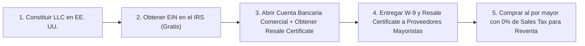

# 📄 Hoja de Referencia Visual (Cheat Sheet) — Módulo 04

## 1. Resumen Ejecutivo del Módulo 04
**Legal y Fiscal Básico: Empresa, Permisos de Reventa, Impuestos y Políticas** — *Orientación práctica sobre LLC, EIN, Resale Certificate, Sales Tax Nexus, reglas de publicidad de la FTC y cuándo consultar a un CPA o abogado.*

* **Nivel:** Básico | **Duración:** 5 horas (2.5 h estudio + 2.5 h gestión documental)
* **Prerrequisitos:** Módulos 02 y 03 completados
* **Proyecto de la Semana:** Carpeta Corporativa B2B y Políticas Legales Bilingües
* **Plantilla Asociada:** `m04-plantillas-politicas-tienda-bilingue.md`

---

## 2. Diagrama Clave de Operación

---

## 3. Reglas de Oro y Lista de Verificación Rápida
* **Ejemplo Numérico Clave:** Si compras a un proveedor un equipo cuyo costo mayorista (*COGS*) es de **US$320** y no tienes **Resale Certificate**, el proveedor te cobrará ~7.5% de *Sales Tax* (**US$24 adicionales**), reduciendo tu ganancia neta de **US$70 a US$46**. Al presentar tu *Resale Certificate*, estás exento de ese impuesto en compras para reventa y ganas **+US$24 extra en cada pedido**.
* **Enfoque Mercado Anglo vs. Hispano:** Tanto la versión en inglés como la versión en español de tus **Políticas de Envío y Devolución** deben decir exactamente lo mismo en plazos (ej. 30 días de devolución, 15% de *restocking fee* en devoluciones por cambio de opinión). En EE. UU., la **FTC** exige que las condiciones clave se presenten en el mismo idioma en que se realiza la venta o el anuncio publicitario.
* **Error Crítico a Evitar:** Mezclar dinero personal con el dinero de la tienda en la misma cuenta o tarjeta, lo cual rompe el velo corporativo (*corporate veil*) de tu LLC y complica la contabilidad.
