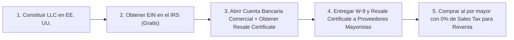

## 🎯 Objetivo de la Lección
Comprender el rol de la LLC (Limited Liability Company), el número fiscal federal (EIN) y la separación entre finanzas personales y empresariales. Además, aplicarás los principios de **Legal y Fiscal Básico: Empresa, Permisos de Reventa, Impuestos y Políticas** directamente a tu catálogo de **3 a 10 productos de alto valor (US$150 a US$800)** para el mercado anglo e hispano de Estados Unidos.

---

## 📖 Explicación Sencilla
Orientación práctica sobre LLC, EIN, Resale Certificate, Sales Tax Nexus, reglas de publicidad de la FTC y cuándo consultar a un CPA o abogado.

Para operar con éxito dentro de tus **12 horas semanales** y proteger tu meta de **US$2,500 de ganancia neta mensual**, este módulo se centra en pasos accionables y medibles:
1. **Comprender el rol de la LLC (Limited Liability Company), el número fiscal federal (EIN) y la separación entre finanzas personales y empresariales.**
2. **Entender cómo funciona el Permiso de Reventa (Resale Certificate / Seller's Permit) y el Nexo Fiscal (Sales Tax Nexus).**
3. **Redactar políticas claras de envío, reembolso, privacidad y términos cumpliendo las normas de la FTC.**
4. **Identificar cuándo consultar a un contador público certificado (CPA) o abogado en EE. UU.**

### Recurso Visual 1: Flujo Operativo del Módulo 04



---

### Recurso Visual 2: Datos e Impacto en Resultados

```chart
{
  "type": "bar",
  "title": "Ahorro en Costo de Compra usando Certificado de Reventa (Pedido de US$500 con COGS US$320)",
  "data": {
    "labels": ["Sin Resale Certificate (Pagando 7.5% Tax)", "Con Resale Certificate (0% Tax Mayorista)"],
    "datasets": [{
      "label": "Ganancia Neta por Pedido (US$)",
      "data": [46, 70],
      "backgroundColor": ["#F59E0B", "#059669"]
    }]
  }
}
```

> [!EJEMPLO_NUMEROS]
> **Ejemplo con números reales aplicados a tu negocio:**
> Si compras a un proveedor un equipo cuyo costo mayorista (*COGS*) es de **US$320** y no tienes **Resale Certificate**, el proveedor te cobrará ~7.5% de *Sales Tax* (**US$24 adicionales**), reduciendo tu ganancia neta de **US$70 a US$46**. Al presentar tu *Resale Certificate*, estás exento de ese impuesto en compras para reventa y ganas **+US$24 extra en cada pedido**.

> [!ANGLO_VS_HISPANO]
> **Mercado Anglo vs. Hispano en EE. UU.:**
> Tanto la versión en inglés como la versión en español de tus **Políticas de Envío y Devolución** deben decir exactamente lo mismo en plazos (ej. 30 días de devolución, 15% de *restocking fee* en devoluciones por cambio de opinión). En EE. UU., la **FTC** exige que las condiciones clave se presenten en el mismo idioma en que se realiza la venta o el anuncio publicitario.

> [!ERROR_COMUN]
> **Error común que debes evitar:**
> Mezclar dinero personal con el dinero de la tienda en la misma cuenta o tarjeta, lo cual rompe el velo corporativo (*corporate veil*) de tu LLC y complica la contabilidad.

---

## 🛠️ Ejercicio Práctico Aplicado a tu Negocio
1. Descarga la plantilla **`m04-plantillas-politicas-tienda-bilingue.md`** desde el botón de esta lección o desde la Biblioteca de Plantillas.
2. Completa tu entregable de la semana: **Carpeta Corporativa B2B y Políticas Legales Bilingües** (Organizar tus documentos para proveedores (LLC, EIN, Resale Certificate / W-9) y publicar las 4 políticas obligatorias de tu tienda en inglés y español.).

---

## ✅ Checklist de la Lección
- [ ] `Tengo clara mi estructura de empresa (LLC + EIN + Cuenta Bancaria Comercial separada).`
- [ ] `Redacté y adapté las políticas de Envío, Devoluciones, Privacidad y Términos en inglés y español.`
- [ ] `Sé exactamente cuándo debo apoyarme en un CPA para declaraciones anuales y Sales Tax.`

---

## 🧠 Mini Quiz de Comprobación

```quiz
[
  {
    "pregunta": "1. ¿Para qué sirve el Certificado de Reventa (Resale Certificate / Seller's Permit) ante tus proveedores en EE. UU.?",
    "opciones": [
      "Para no pagar impuestos sobre la renta nunca.",
      "Para acreditar que compras los productos con fines de reventa minorista, permitiéndote abrir cuentas con distribuidores mayoristas y comprarles sin que te cobren Sales Tax.",
      "Para viajar sin pasaporte.",
      "Para registrar una marca propia."
    ],
    "correcta": 1,
    "explicacion": "En EE. UU., el impuesto sobre las ventas (Sales Tax) lo paga el consumidor final; el Resale Certificate evita que tú lo pagues al comprar al por mayor."
  },
  {
    "pregunta": "2. ¿Cuándo debes consultar obligatoriamente a un contador público certificado (CPA) o abogado en EE. UU.?",
    "opciones": [
      "Nunca, todo se hace por intuición.",
      "Al elegir el estado de constitución según si eres residente o extranjero (formularios IRS 5472/1120 o Schedule C), configurar tus obligaciones de Sales Tax Nexus y presentar tus declaraciones fiscales anuales.",
      "Para elegir el color del botón de compra.",
      "Cada vez que hablas con un cliente."
    ],
    "correcta": 1,
    "explicacion": "Esta guía es orientación educativa general; para tu situación fiscal personal (especialmente formularios del IRS y nexo estatal) siempre debes validar con un CPA."
  },
  {
    "pregunta": "3. Si haces publicidad en español en EE. UU., ¿en qué idioma deben estar visibles las condiciones de envío, garantía y devolución para ese comprador?",
    "opciones": [
      "Solo en inglés con letra diminuta.",
      "Claramente visibles tanto en español como en inglés, con exactamente las mismas condiciones transparentes.",
      "En ningún idioma.",
      "Solo por teléfono."
    ],
    "correcta": 1,
    "explicacion": "Las reglas de la FTC sobre divulgaciones claras y visibles ('Clear and Conspicuous Disclosures') exigen que las políticas estén en el mismo idioma del anuncio y la experiencia de compra."
  }
]
```

---

## 🎯 Entregable de la Lección
Completa tu archivo **`m04-plantillas-politicas-tienda-bilingue.md`** y marca los criterios del **Checkpoint del Módulo 04** cuando estés listo/a para avanzar.
