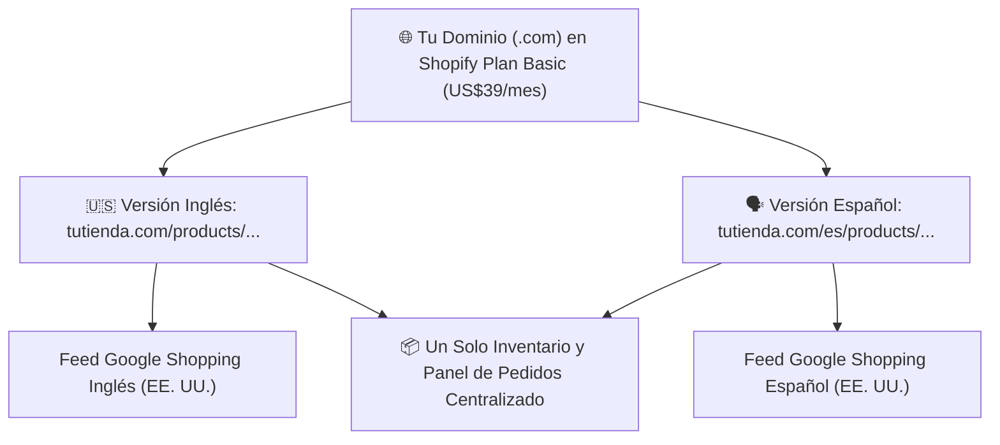

# 📄 Hoja de Referencia Visual (Cheat Sheet) — Módulo 05

## 1. Resumen Ejecutivo del Módulo 05
**Tienda Bilingüe: Plataforma, Dominio, Marca y Páginas de Producto (EN/ES)** — *Cómo construir una tienda rápida, confiable y bilingüe que enamore a proveedores B2B, apruebe Google Merchant Center y convierta visitantes en compradores.*

* **Nivel:** Intermedio | **Duración:** 10 horas (3 h estudio + 7 h construcción)
* **Prerrequisitos:** Módulos 03 y 04 completados
* **Proyecto de la Semana:** Tienda Bilingüe Publicada con tus Primeros 3 a 5 Productos
* **Plantilla Asociada:** `m04-plantillas-politicas-tienda-bilingue.md`

---

## 2. Diagrama Clave de Operación

---

## 3. Reglas de Oro y Lista de Verificación Rápida
* **Ejemplo Numérico Clave:** En lugar de pagar dos tiendas separadas (`US$39 x 2 = US$78/mes`), usas **una sola tienda Shopify Basic (US$39/mes)** con la aplicación oficial gratuita **Shopify Translate & Adapt**. Esto habilita subcarpetas automáticas (`tutienda.com` y `tutienda.com/es`) con etiquetas SEO `hreflang`, ahorrándote **US$468 al año** y centralizando todos tus pedidos.
* **Enfoque Mercado Anglo vs. Hispano:** En la versión en inglés (`/`), destaca en el encabezado: **'Authorized U.S. Dealer · Free Shipping to Lower 48 · Call an Expert: (800) XXX-XXXX'**. En la versión en español (`/es`), localízalo como: **'Distribuidor Autorizado en EE. UU. · Envío Gratis (48 Estados) · Habla con un Especialista en Español por Teléfono o WhatsApp'**.
* **Error Crítico a Evitar:** Activar un plugin de traducción automática sin revisar los textos: traduce medidas o nombres de piezas de forma incomprensible y destruye la credibilidad de un producto de US$500.
