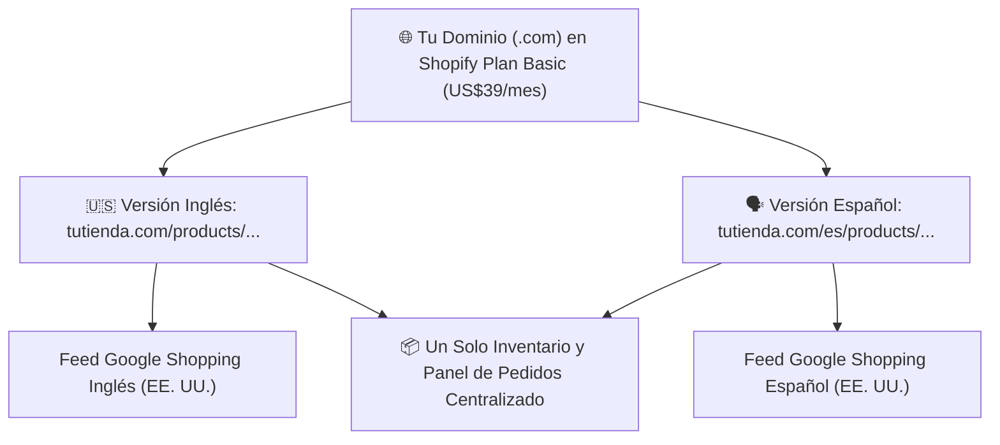

## 🎯 Objetivo de la Lección
Configurar tu tienda con estructura de URLs bilingüe limpia (tutienda.com en inglés y tutienda.com/es en español) usando Shopify Translate & Adapt. Además, aplicarás los principios de **Tienda Bilingüe: Plataforma, Dominio, Marca y Páginas de Producto (EN/ES)** directamente a tu catálogo de **3 a 10 productos de alto valor (US$150 a US$800)** para el mercado anglo e hispano de Estados Unidos.

---

## 📖 Explicación Sencilla
Cómo construir una tienda rápida, confiable y bilingüe que enamore a proveedores B2B, apruebe Google Merchant Center y convierta visitantes en compradores.

Para operar con éxito dentro de tus **12 horas semanales** y proteger tu meta de **US$2,500 de ganancia neta mensual**, este módulo se centra en pasos accionables y medibles:
1. **Configurar tu tienda con estructura de URLs bilingüe limpia (tutienda.com en inglés y tutienda.com/es en español) usando Shopify Translate & Adapt.**
2. **Diseñar una identidad visual sobria de distribuidor especializado para un catálogo de 3 a 10 productos.**
3. **Construir páginas de producto (PDP) de alta conversión con fichas técnicas, garantías y botones de consulta telefónica/WhatsApp.**
4. **Cumplir el 100% de los requisitos técnicos de Google Merchant Center para evitar bloqueos.**

### Recurso Visual 1: Flujo Operativo del Módulo 05



---

### Recurso Visual 2: Datos e Impacto en Resultados

```chart
{
  "type": "bar",
  "title": "Elementos que Más Influyen en la Confianza al Comprar US$400+ en una Tienda Nueva (%)",
  "data": {
    "labels": ["Teléfono y WhatsApp Visibles", "Especificaciones y Garantía Clara", "Tiempos de Envío Reales", "Opción de Cuotas BNPL"],
    "datasets": [{
      "label": "% de Compradores que lo Consideran Decisivo",
      "data": [84, 91, 88, 72],
      "backgroundColor": ["#0284C7", "#059669", "#4F46E5", "#D97706"]
    }]
  }
}
```

> [!EJEMPLO_NUMEROS]
> **Ejemplo con números reales aplicados a tu negocio:**
> En lugar de pagar dos tiendas separadas (`US$39 x 2 = US$78/mes`), usas **una sola tienda Shopify Basic (US$39/mes)** con la aplicación oficial gratuita **Shopify Translate & Adapt**. Esto habilita subcarpetas automáticas (`tutienda.com` y `tutienda.com/es`) con etiquetas SEO `hreflang`, ahorrándote **US$468 al año** y centralizando todos tus pedidos.

> [!ANGLO_VS_HISPANO]
> **Mercado Anglo vs. Hispano en EE. UU.:**
> En la versión en inglés (`/`), destaca en el encabezado: **'Authorized U.S. Dealer · Free Shipping to Lower 48 · Call an Expert: (800) XXX-XXXX'**. En la versión en español (`/es`), localízalo como: **'Distribuidor Autorizado en EE. UU. · Envío Gratis (48 Estados) · Habla con un Especialista en Español por Teléfono o WhatsApp'**.

> [!ERROR_COMUN]
> **Error común que debes evitar:**
> Activar un plugin de traducción automática sin revisar los textos: traduce medidas o nombres de piezas de forma incomprensible y destruye la credibilidad de un producto de US$500.

---

## 🛠️ Ejercicio Práctico Aplicado a tu Negocio
1. Descarga la plantilla **`m04-plantillas-politicas-tienda-bilingue.md`** desde el botón de esta lección o desde la Biblioteca de Plantillas.
2. Completa tu entregable de la semana: **Tienda Bilingüe Publicada con tus Primeros 3 a 5 Productos** (Configurar tu tienda con subcarpeta bilingüe (/ y /es), teléfono visible, botón de WhatsApp y páginas de producto completas en inglés y español.).

---

## ✅ Checklist de la Lección
- [ ] `Mi tienda carga en menos de 2.5 segundos en celular tanto en inglés como en español.`
- [ ] `El teléfono comercial, correo, dirección física/registrada y las 4 políticas legales están visibles en el pie de página (footer).`
- [ ] `Mis primeros 3 a 5 productos tienen descripciones localizadas, especificaciones claras y botón de consulta.`

---

## 🧠 Mini Quiz de Comprobación

```quiz
[
  {
    "pregunta": "1. ¿Cómo debemos estructurar técnicamente nuestra tienda para vender tanto al público anglo como al hispano en EE. UU. sin duplicar gastos fijos?",
    "opciones": [
      "Pagando dos tiendas separadas en dos dominios distintos.",
      "Mezclando párrafos en inglés y en español dentro de la misma página.",
      "Usando una sola tienda con subcarpetas de idioma nativas (tutienda.com para inglés y tutienda.com/es para español) y localización humana revisada.",
      "Poniendo fotos sin texto."
    ],
    "correcta": 2,
    "explicacion": "Las subcarpetas por idioma con etiquetas hreflang mantienen un solo inventario, un solo costo fijo y permiten anunciar en Google Shopping en ambos idiomas."
  },
  {
    "pregunta": "2. ¿Qué elementos son obligatorios en el pie de página (footer) y cabecera para que Google Merchant Center y los proveedores B2B aprueben tu tienda?",
    "opciones": [
      "Solo un formulario sin correo ni teléfono.",
      "Teléfono comercial activo, correo corporativo (@tudominio.com), dirección comercial real y enlaces visibles a Políticas de Envío, Devolución, Privacidad y Términos.",
      "Un contador regresivo de ofertas.",
      "Logos de marcas que no vendes."
    ],
    "correcta": 1,
    "explicacion": "La ausencia de datos de contacto verificables (teléfono, dirección y correo corporativo) es la causa #1 de suspensión por 'Misrepresentation' en Google Merchant Center."
  },
  {
    "pregunta": "3. En una página de producto de US$450, ¿qué información técnica nunca puede faltar?",
    "opciones": [
      "Dimensiones exactas, peso, voltaje/especificaciones, qué incluye la caja, garantía oficial en EE. UU., tiempo real de preparación y entrega, y botón de consulta directa.",
      "Solo una frase motivacional.",
      "Chistes sobre el producto.",
      "Comentarios inventados."
    ],
    "correcta": 0,
    "explicacion": "El comprador de alto valor toma decisiones racionales basadas en especificaciones completas y respaldo postventa."
  }
]
```

---

## 🎯 Entregable de la Lección
Completa tu archivo **`m04-plantillas-politicas-tienda-bilingue.md`** y marca los criterios del **Checkpoint del Módulo 05** cuando estés listo/a para avanzar.
