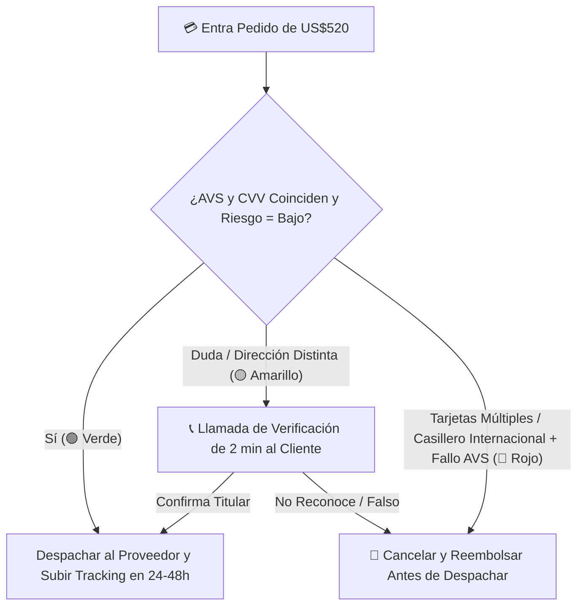

# 📄 Hoja de Referencia Visual (Cheat Sheet) — Módulo 06

## 1. Resumen Ejecutivo del Módulo 06
**Pagos y Fraude: Procesadores, Límites, Prevención de Contracargos y BNPL** — *Cómo cobrar tickets de US$150 a US$800 sin bloqueos sorpresivos, activar pagos en cuotas (BNPL) y blindarte contra el fraude.*

* **Nivel:** Intermedio | **Duración:** 5 horas (2.5 h estudio + 2.5 h configuración)
* **Prerrequisitos:** Módulos 04 y 05 completados
* **Proyecto de la Semana:** Configuración de Pasarelas, BNPL y Semáforo Antifraude
* **Plantilla Asociada:** `m06-protocolo-semaforo-antifraude.md`

---

## 2. Diagrama Clave de Operación

---

## 3. Reglas de Oro y Lista de Verificación Rápida
* **Ejemplo Numérico Clave:** Un estafador intenta comprar una estación de energía de **US$680** con una tarjeta robada pidiendo envío a un casillero de reenvío en Miami mientras la tarjeta pertenece a un banco en Oregón (**Semáforo Rojo / Amarillo**). Si despacharas a ciegas, perderías **US$680 + US$15 de multa**. Al aplicar el protocolo de **2 minutos de llamada telefónica antes de pedir al proveedor**, detectas que el teléfono no corresponde al titular, cancelas el pedido en Shopify sin despachar nada y tu pérdida es **US$0**.
* **Enfoque Mercado Anglo vs. Hispano:** En el mercado hispano y anglo joven (Millennials y Gen Z representan el **65% del gasto hispano en EE. UU.**), destacar visiblemente debajo del precio: **'Págalo en 4 cuotas sin intereses de US$112.50 con Shop Pay / Affirm'** reduce drásticamente el abandono del carrito.
* **Error Crítico a Evitar:** No subir el número de guía (*tracking number*) dentro de la pasarela de pagos (Shopify Payments y PayPal): si el procesador no ve números de rastreo reales de UPS/FedEx, asume que no estás enviando los productos y congela tus fondos.
