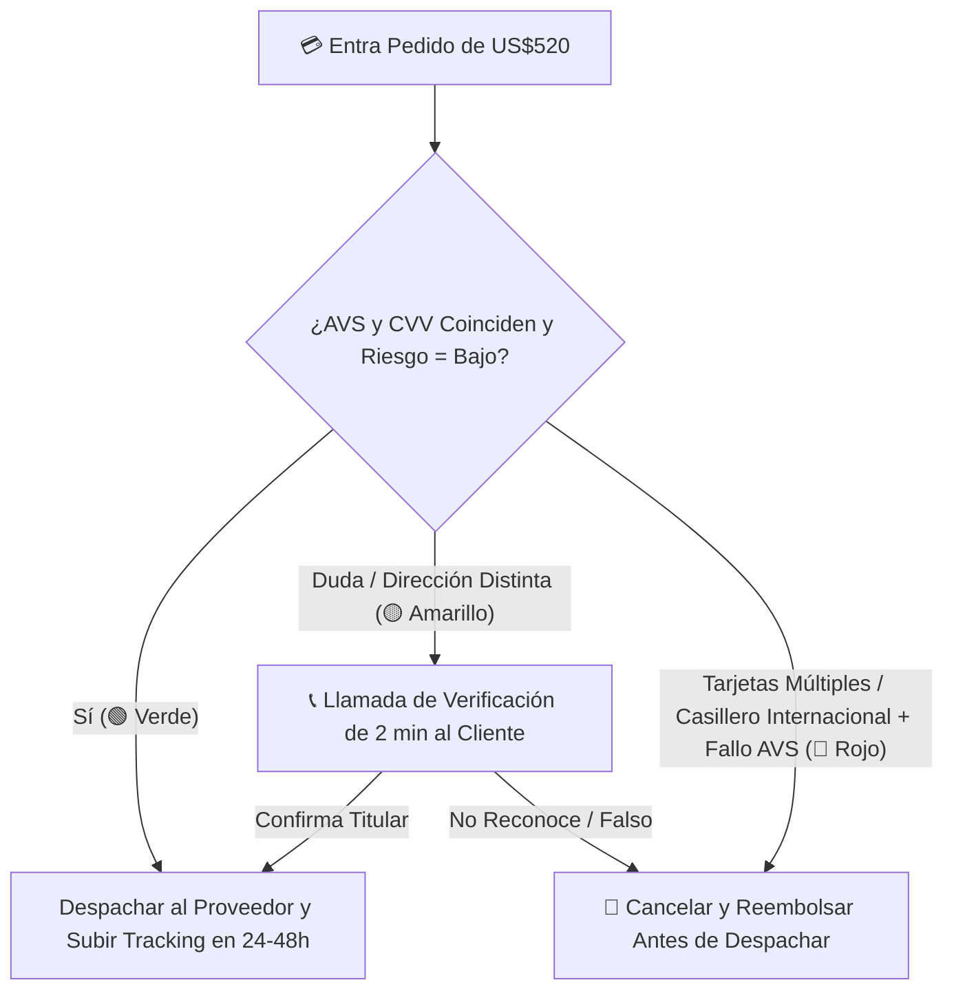

## 🎯 Objetivo de la Lección
Configurar procesadores de pago minimizando el riesgo de retenciones prolongadas en tickets altos. Además, aplicarás los principios de **Pagos y Fraude: Procesadores, Límites, Prevención de Contracargos y BNPL** directamente a tu catálogo de **3 a 10 productos de alto valor (US$150 a US$800)** para el mercado anglo e hispano de Estados Unidos.

---

## 📖 Explicación Sencilla
Cómo cobrar tickets de US$150 a US$800 sin bloqueos sorpresivos, activar pagos en cuotas (BNPL) y blindarte contra el fraude.

Para operar con éxito dentro de tus **12 horas semanales** y proteger tu meta de **US$2,500 de ganancia neta mensual**, este módulo se centra en pasos accionables y medibles:
1. **Configurar procesadores de pago minimizando el riesgo de retenciones prolongadas en tickets altos.**
2. **Activar financiamiento instantáneo BNPL (Shop Pay Installments / Affirm / Klarna) para elevar la conversión.**
3. **Aplicar el Semáforo Antifraude (Verde, Amarillo y Rojo) antes de enviar cualquier orden al proveedor.**
4. **Armar paquetes de evidencia ganadores en caso de disputas o contracargos.**

### Recurso Visual 1: Flujo Operativo del Módulo 06



---

### Recurso Visual 2: Datos e Impacto en Resultados

```chart
{
  "type": "bar",
  "title": "Aumento en Tasa de Conversión al Activar Pagos en Cuotas (BNPL) por Rango de Precio (%)",
  "data": {
    "labels": ["Ticket US$150 - US$250", "Ticket US$251 - US$500", "Ticket US$501 - US$800"],
    "datasets": [
      {"label": "Sin BNPL (Solo Contado)", "data": [1.9, 1.3, 0.8], "backgroundColor": "#94A3B8"},
      {"label": "Con BNPL Activo (4 pagos / Cuotas)", "data": [2.3, 2.0, 1.5], "backgroundColor": "#15803D"}
    ]
  }
}
```

> [!EJEMPLO_NUMEROS]
> **Ejemplo con números reales aplicados a tu negocio:**
> Un estafador intenta comprar una estación de energía de **US$680** con una tarjeta robada pidiendo envío a un casillero de reenvío en Miami mientras la tarjeta pertenece a un banco en Oregón (**Semáforo Rojo / Amarillo**). Si despacharas a ciegas, perderías **US$680 + US$15 de multa**. Al aplicar el protocolo de **2 minutos de llamada telefónica antes de pedir al proveedor**, detectas que el teléfono no corresponde al titular, cancelas el pedido en Shopify sin despachar nada y tu pérdida es **US$0**.

> [!ANGLO_VS_HISPANO]
> **Mercado Anglo vs. Hispano en EE. UU.:**
> En el mercado hispano y anglo joven (Millennials y Gen Z representan el **65% del gasto hispano en EE. UU.**), destacar visiblemente debajo del precio: **'Págalo en 4 cuotas sin intereses de US$112.50 con Shop Pay / Affirm'** reduce drásticamente el abandono del carrito.

> [!ERROR_COMUN]
> **Error común que debes evitar:**
> No subir el número de guía (*tracking number*) dentro de la pasarela de pagos (Shopify Payments y PayPal): si el procesador no ve números de rastreo reales de UPS/FedEx, asume que no estás enviando los productos y congela tus fondos.

---

## 🛠️ Ejercicio Práctico Aplicado a tu Negocio
1. Descarga la plantilla **`m06-protocolo-semaforo-antifraude.md`** desde el botón de esta lección o desde la Biblioteca de Plantillas.
2. Completa tu entregable de la semana: **Configuración de Pasarelas, BNPL y Semáforo Antifraude** (Activar Shopify Payments + PayPal Business + Pago en Cuotas (BNPL) e implementar las reglas automáticas de bloqueo AVS/CVV más el protocolo de llamada antifraude.).

---

## ✅ Checklist de la Lección
- [ ] `Mis pasarelas de pago y la opción de cuotas BNPL están activas y probadas.`
- [ ] `Configuré el bloqueo automático cuando falla el código CVV o el código postal AVS.`
- [ ] `Descargué y tengo en mi escritorio el protocolo m06-protocolo-semaforo-antifraude.md.`

---

## 🧠 Mini Quiz de Comprobación

```quiz
[
  {
    "pregunta": "1. ¿Qué debes hacer SIEMPRE antes de pagarle al proveedor cuando entra un pedido de US$550 en Semáforo Amarillo (ej. dirección de envío distinta a la de facturación)?",
    "opciones": [
      "Enviar el producto rápido sin preguntar.",
      "Hacer una llamada telefónica de cortesía y seguridad de 2 minutos al cliente para confirmar su dirección de entrega y verificar que sea una compra legítima.",
      "Bloquear la tienda por una semana.",
      "Cobrarle el doble."
    ],
    "correcta": 1,
    "explicacion": "Esa llamada de 2 minutos frena en seco a cualquier estafador y al mismo tiempo encanta al cliente real, quien siente que compró en una empresa seria y atenta."
  },
  {
    "pregunta": "2. ¿Quién asume el riesgo de impago de las cuotas cuando un cliente compra en tu tienda usando Shop Pay Installments, Affirm o Klarna (BNPL)?",
    "opciones": [
      "Tú tienes que cobrarle mes a mes al cliente.",
      "La entidad financiera de BNPL asume el riesgo crediticio de las cuotas; a ti te depositan el monto total de la venta por adelantado (menos la comisión de procesamiento).",
      "El proveedor del producto.",
      "El empresa de envíos UPS."
    ],
    "correcta": 1,
    "explicacion": "Las plataformas BNPL te pagan el pedido completo de inmediato (descontando su comisión del ~5.5%-5.9%) y ellas se encargan de cobrar las cuotas al comprador."
  },
  {
    "pregunta": "3. ¿Cuál es la práctica más importante para evitar que Stripe, Shopify Payments o PayPal retengan tus fondos (Account Hold) cuando empiezas a vender tickets altos?",
    "opciones": [
      "No contestar los correos del procesador.",
      "Cargar puntualmente el número de guía (tracking number) de UPS/FedEx en cada orden apenas despacha el proveedor y mantener cero disputas mediante atención proactiva.",
      "Cambiar de cuenta bancaria todos los días.",
      "Ocultar tu teléfono de contacto."
    ],
    "correcta": 1,
    "explicacion": "Los procesadores liberan fondos con fluidez cuando ven números de guía válidos entregados a tiempo y clientes satisfechos."
  }
]
```

---

## 🎯 Entregable de la Lección
Completa tu archivo **`m06-protocolo-semaforo-antifraude.md`** y marca los criterios del **Checkpoint del Módulo 06** cuando estés listo/a para avanzar.
