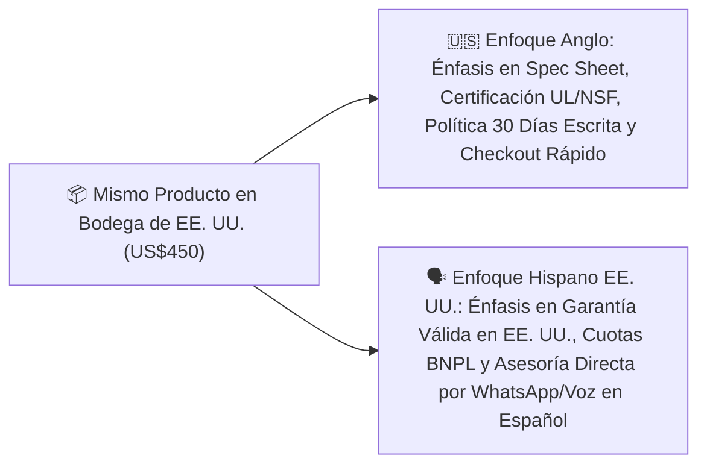

# 📄 Hoja de Referencia Visual (Cheat Sheet) — Módulo 07

## 1. Resumen Ejecutivo del Módulo 07
**Dos Mercados, Una Operación: Localización Anglo vs. Hispano Basada en Datos** — *Cómo adaptar mensajes, creatividades, señales de confianza y atención para vender con éxito al público anglo e hispano en EE. UU. sin estereotipos.*

* **Nivel:** Intermedio | **Duración:** 5 horas (2.5 h estudio + 2.5 h localización)
* **Prerrequisitos:** Módulo 05 completado
* **Proyecto de la Semana:** Localización Cultural de tus 3 Productos Estrella y 6 Anuncios Base
* **Plantilla Asociada:** `m09-guiones-venta-consultiva-whatsapp-telefono.md`

---

## 2. Diagrama Clave de Operación

---

## 3. Reglas de Oro y Lista de Verificación Rápida
* **Ejemplo Numérico Clave:** Mira la diferencia entre **traducción literal** y **localización efectiva** para EE. UU.:
* **Original (EN):** *'Heavy-Duty 48" Commercial Worktable — Free Curbside Delivery in the Lower 48'*
* ❌ **Mala traducción literal:** *'Mesa de trabajo pesado de 48" — Entrega libre en la acera en los 48 inferiores'*
* ✅ **Localización efectiva para Hispanos en EE. UU.:** *'Mesa de Acero Inoxidable de Uso Rudo Comercial (48 pulgadas) — Envío Gratis a Domicilio en EE. UU. y Garantía de Fábrica'*.
* **Enfoque Mercado Anglo vs. Hispano:** Nota crítica sobre **unidades de medida en EE. UU.**: Aunque escribas en español, tu comprador hispano vive y trabaja en Estados Unidos, por lo que mide espacios en **pulgadas (*inches*), pies (*feet*) y libras (*lbs*)**, y usa corriente de **110V/120V**. ¡Nunca conviertas las medidas solo a centímetros o voltios europeos en tu página en español!
* **Error Crítico a Evitar:** Usar jerga regional cerrada de un solo país o caer en estereotipos folclóricos en los anuncios. Usa un **español neutro, profesional, cálido y directo**, manteniendo entre paréntesis el término técnico en inglés que se usa en EE. UU. (ej. *'Certificación NSF (Health Department Approved)'*).
