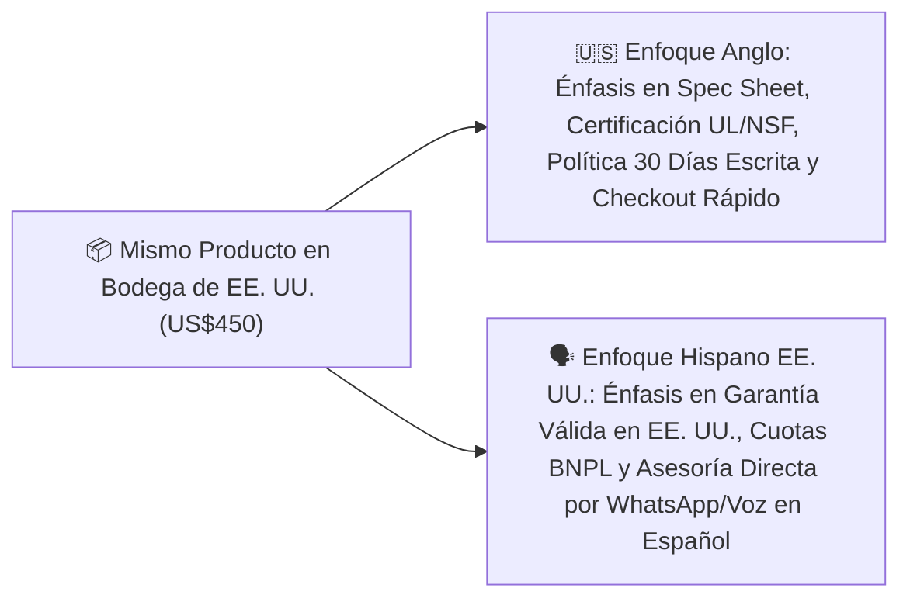

## 🎯 Objetivo de la Lección
Sustituir la traducción literal por la localización cultural y comercial (transcreation) basada en datos demográficos reales. Además, aplicarás los principios de **Dos Mercados, Una Operación: Localización Anglo vs. Hispano Basada en Datos** directamente a tu catálogo de **3 a 10 productos de alto valor (US$150 a US$800)** para el mercado anglo e hispano de Estados Unidos.

---

## 📖 Explicación Sencilla
Cómo adaptar mensajes, creatividades, señales de confianza y atención para vender con éxito al público anglo e hispano en EE. UU. sin estereotipos.

Para operar con éxito dentro de tus **12 horas semanales** y proteger tu meta de **US$2,500 de ganancia neta mensual**, este módulo se centra en pasos accionables y medibles:
1. **Sustituir la traducción literal por la localización cultural y comercial (transcreation) basada en datos demográficos reales.**
2. **Adaptar las señales de confianza (trust signals) a lo que más valora cada segmento en EE. UU.**
3. **Aprovechar el menor costo por clic (CPC) de las búsquedas en español dentro de EE. UU. sin descuidar el volumen del mercado anglo.**
4. **Operar ambos mercados con un solo flujo de trabajo.**

### Recurso Visual 1: Flujo Operativo del Módulo 07



---

### Recurso Visual 2: Datos e Impacto en Resultados

```chart
{
  "type": "bar",
  "title": "Datos Reales del Mercado Hispano en EE. UU. vs. Promedio General (Fuentes: Pew Research / LDC)",
  "data": {
    "labels": ["Edad Mediana (Años)", "% Gasto en Millennials y Gen Z", "Crecimiento del Consumo Familiar (Índice)"],
    "datasets": [
      {"label": "Mercado Hispano en EE. UU.", "data": [31.2, 65, 210], "backgroundColor": "#D97706"},
      {"label": "Mercado No-Hispano en EE. UU.", "data": [43.2, 42, 100], "backgroundColor": "#3B82F6"}
    ]
  }
}
```

> [!EJEMPLO_NUMEROS]
> **Ejemplo con números reales aplicados a tu negocio:**
> Mira la diferencia entre **traducción literal** y **localización efectiva** para EE. UU.:
* **Original (EN):** *'Heavy-Duty 48" Commercial Worktable — Free Curbside Delivery in the Lower 48'*
* ❌ **Mala traducción literal:** *'Mesa de trabajo pesado de 48" — Entrega libre en la acera en los 48 inferiores'*
* ✅ **Localización efectiva para Hispanos en EE. UU.:** *'Mesa de Acero Inoxidable de Uso Rudo Comercial (48 pulgadas) — Envío Gratis a Domicilio en EE. UU. y Garantía de Fábrica'*.

> [!ANGLO_VS_HISPANO]
> **Mercado Anglo vs. Hispano en EE. UU.:**
> Nota crítica sobre **unidades de medida en EE. UU.**: Aunque escribas en español, tu comprador hispano vive y trabaja en Estados Unidos, por lo que mide espacios en **pulgadas (*inches*), pies (*feet*) y libras (*lbs*)**, y usa corriente de **110V/120V**. ¡Nunca conviertas las medidas solo a centímetros o voltios europeos en tu página en español!

> [!ERROR_COMUN]
> **Error común que debes evitar:**
> Usar jerga regional cerrada de un solo país o caer en estereotipos folclóricos en los anuncios. Usa un **español neutro, profesional, cálido y directo**, manteniendo entre paréntesis el término técnico en inglés que se usa en EE. UU. (ej. *'Certificación NSF (Health Department Approved)'*).

---

## 🛠️ Ejercicio Práctico Aplicado a tu Negocio
1. Descarga la plantilla **`m09-guiones-venta-consultiva-whatsapp-telefono.md`** desde el botón de esta lección o desde la Biblioteca de Plantillas.
2. Completa tu entregable de la semana: **Localización Cultural de tus 3 Productos Estrella y 6 Anuncios Base** (Reescribir y localizar (sin traducir literalmente) las propuestas de valor, titulares y señales de confianza de tus productos principales para ambos mercados.).

---

## ✅ Checklist de la Lección
- [ ] `Mis páginas en español usan vocabulario comercial natural de EE. UU. (incluyendo unidades en pulgadas/libras junto a referencia clara).`
- [ ] `Eliminé cualquier cliché o estereotipo y basé mis argumentos en beneficios reales: garantía en EE. UU., envío rápido y asesoría humana.`
- [ ] `Tengo listos mis 3 anuncios en inglés y 3 en español localizado.`

---

## 🧠 Mini Quiz de Comprobación

```quiz
[
  {
    "pregunta": "1. Según los datos verificados de Pew Research Center y LDC Latino GDP, ¿cuál es una característica clave del consumidor hispano en EE. UU.?",
    "opciones": [
      "No utiliza teléfonos inteligentes para comprar.",
      "Es una población mucho más joven (edad mediana de 31.2 años), donde Millennials y Gen Z representan el 65% del gasto, con altísima adopción móvil y un poder adquisitivo de US$4.1 billones.",
      "Solo compra en tiendas físicas.",
      "Prefiere envíos que tarden más de un mes."
    ],
    "correcta": 1,
    "explicacion": "La juventud demográfica y penetración móvil hacen que la experiencia en celular + WhatsApp convierta de forma sobresaliente en este segmento."
  },
  {
    "pregunta": "2. En la versión en español de tu tienda para Estados Unidos, ¿qué unidades de medida debes mostrar en las especificaciones del producto?",
    "opciones": [
      "Solo milímetros y kilogramos.",
      "Pulgadas (in), pies (ft) y libras (lb) como medida principal —porque el comprador vive y mide su casa o negocio en EE. UU.—, pudiendo añadir centímetros entre paréntesis como referencia.",
      "Leguas y arrobas.",
      "Ninguna medida."
    ],
    "correcta": 1,
    "explicacion": "En EE. UU., los contratistas, dueños de negocios y propietarios hispanos compran usando medidas imperiales (ej. puerta de 36 pulgadas, mesa de 48 pulgadas)."
  },
  {
    "pregunta": "3. ¿Qué es localizar (localization) frente a traducir literalmente?",
    "opciones": [
      "Pasar el texto por un traductor automático sin leerlo.",
      "Adaptar el mensaje, los beneficios y los términos técnicos de uso común en EE. UU. para que suenen naturales, claros y confiables para el comprador de cada idioma.",
      "Cambiar el precio según el idioma.",
      "Borrar las especificaciones técnicas."
    ],
    "correcta": 1,
    "explicacion": "Localizar conserva los términos técnicos estándar de EE. UU. (como NSF, Heavy-Duty, Free Shipping) explicados en un español comercial claro y cercano."
  }
]
```

---

## 🎯 Entregable de la Lección
Completa tu archivo **`m09-guiones-venta-consultiva-whatsapp-telefono.md`** y marca los criterios del **Checkpoint del Módulo 07** cuando estés listo/a para avanzar.
