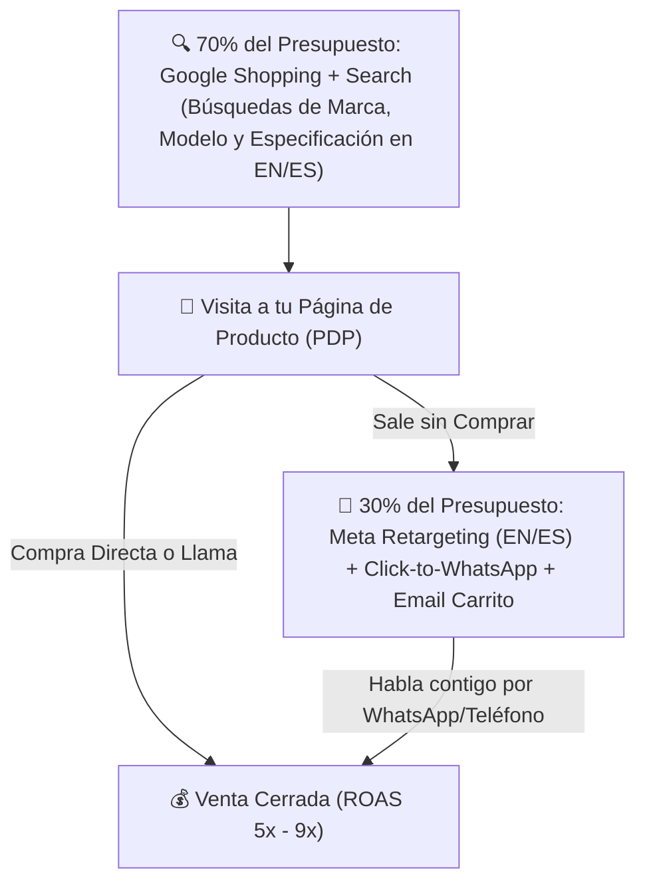

# 📄 Hoja de Referencia Visual (Cheat Sheet) — Módulo 08

## 1. Resumen Ejecutivo del Módulo 08
**Tráfico y Ventas: Google Shopping, Meta Ads, Orgánico y Presupuesto de Pruebas** — *Cómo atraer compradores con tarjeta en mano en inglés y español controlando estrictamente tu CPA, tu ROAS de equilibrio y tu presupuesto inicial.*

* **Nivel:** Avanzado | **Duración:** 8 horas (3.5 h estudio + 4.5 h campañas)
* **Prerrequisitos:** Módulos 03, 05, 06 y 07 completados
* **Proyecto de la Semana:** Estructura de Campañas Google Shopping + Retargeting Bilingüe
* **Plantilla Asociada:** `m11-tablero-semanal-kpis-y-reglas-escala.csv`

---

## 2. Diagrama Clave de Operación

---

## 3. Reglas de Oro y Lista de Verificación Rápida
* **Ejemplo Numérico Clave:** Con un presupuesto de prueba mensual de **US$750** (`US$25/día`), asignas **US$525 (70%) a Google Shopping/Search** filtrando palabras negativas (*'free', 'used', 'parts', 'repair', 'amazon', 'barato', 'usado'*) y **US$225 (30%) a Retargeting en Meta Ads con botón a WhatsApp** para quienes visitaron un producto pero no compraron. Con 11 ventas cerradas en el mes y un margen antes de anuncios de US$130/orden (`11 x US$130 = US$1,430`), recuperas los US$750 de anuncios y obtienes **+US$680 de ganancia neta** desde la fase de prueba.
* **Enfoque Mercado Anglo vs. Hispano:** En **Meta Ads (Facebook/Instagram)** dentro de Estados Unidos, puedes crear un conjunto de anuncios específico con ubicación **Estados Unidos + Idioma: Español** con botón **'Enviar mensaje de WhatsApp'** (*Click-to-WhatsApp*). Para productos de US$300 a US$800, el comprador hispano convierte hasta **3 veces mejor** iniciando una conversación de WhatsApp de 2 minutos contigo que yendo a un formulario frío.
* **Error Crítico a Evitar:** Lanzar campañas de 'Tráfico Frío por Intereses' en Facebook o TikTok para intentar vender un producto técnico de US$500 a personas que no lo están buscando. Empieza siempre por **búsqueda con intención en Google Shopping** + **Retargeting**.
