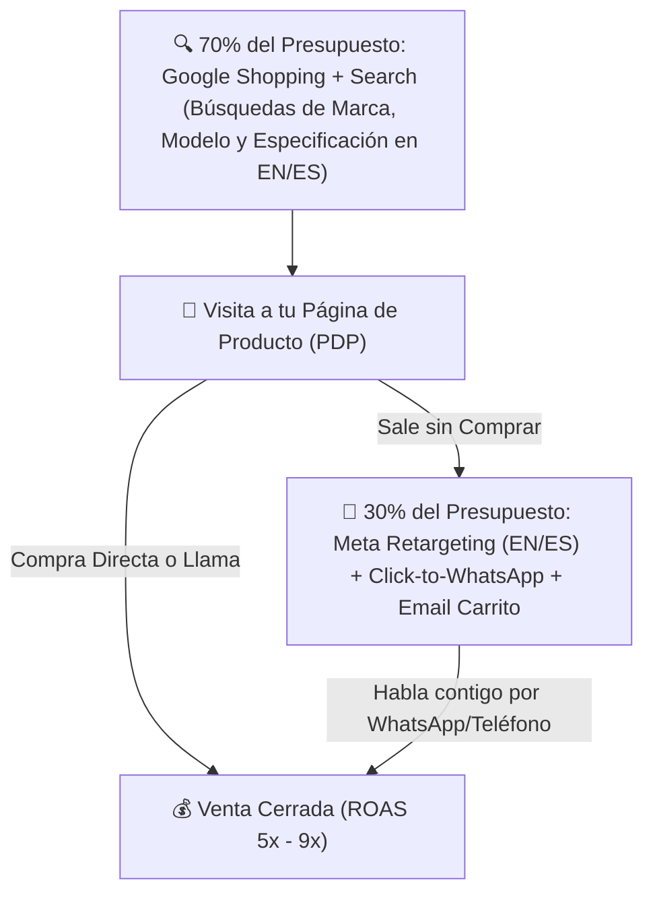

## 🎯 Objetivo de la Lección
Configurar Google Merchant Center y campañas de Google Shopping Estándar para capturar búsquedas de marca y modelo (SKU). Además, aplicarás los principios de **Tráfico y Ventas: Google Shopping, Meta Ads, Orgánico y Presupuesto de Pruebas** directamente a tu catálogo de **3 a 10 productos de alto valor (US$150 a US$800)** para el mercado anglo e hispano de Estados Unidos.

---

## 📖 Explicación Sencilla
Cómo atraer compradores con tarjeta en mano en inglés y español controlando estrictamente tu CPA, tu ROAS de equilibrio y tu presupuesto inicial.

Para operar con éxito dentro de tus **12 horas semanales** y proteger tu meta de **US$2,500 de ganancia neta mensual**, este módulo se centra en pasos accionables y medibles:
1. **Configurar Google Merchant Center y campañas de Google Shopping Estándar para capturar búsquedas de marca y modelo (SKU).**
2. **Crear campañas en Meta Ads segmentadas por idioma en EE. UU. para Retargeting y consultas por WhatsApp.**
3. **Implementar recuperación automática de carritos abandonados por correo y contacto humano.**
4. **Administrar un presupuesto de pruebas (ej. US$500 a US$1,000) usando reglas de CPA Máximo y ROAS de Equilibrio.**

### Recurso Visual 1: Flujo Operativo del Módulo 08



---

### Recurso Visual 2: Datos e Impacto en Resultados

```chart
{
  "type": "bar",
  "title": "Distribución Óptima de un Presupuesto de Prueba de US$750/mes y Retorno Esperado (US$)",
  "data": {
    "labels": ["Google Shopping (Marca/SKU)", "Google Search Bilingüe (ES/EN)", "Meta Retargeting + WhatsApp"],
    "datasets": [
      {"label": "Inversión Publicitaria (US$)", "data": [400, 200, 150], "backgroundColor": "#EA580C"},
      {"label": "Ventas Brutas Generadas (US$)", "data": [2400, 1350, 1200], "backgroundColor": "#10B981"}
    ]
  }
}
```

> [!EJEMPLO_NUMEROS]
> **Ejemplo con números reales aplicados a tu negocio:**
> Con un presupuesto de prueba mensual de **US$750** (`US$25/día`), asignas **US$525 (70%) a Google Shopping/Search** filtrando palabras negativas (*'free', 'used', 'parts', 'repair', 'amazon', 'barato', 'usado'*) y **US$225 (30%) a Retargeting en Meta Ads con botón a WhatsApp** para quienes visitaron un producto pero no compraron. Con 11 ventas cerradas en el mes y un margen antes de anuncios de US$130/orden (`11 x US$130 = US$1,430`), recuperas los US$750 de anuncios y obtienes **+US$680 de ganancia neta** desde la fase de prueba.

> [!ANGLO_VS_HISPANO]
> **Mercado Anglo vs. Hispano en EE. UU.:**
> En **Meta Ads (Facebook/Instagram)** dentro de Estados Unidos, puedes crear un conjunto de anuncios específico con ubicación **Estados Unidos + Idioma: Español** con botón **'Enviar mensaje de WhatsApp'** (*Click-to-WhatsApp*). Para productos de US$300 a US$800, el comprador hispano convierte hasta **3 veces mejor** iniciando una conversación de WhatsApp de 2 minutos contigo que yendo a un formulario frío.

> [!ERROR_COMUN]
> **Error común que debes evitar:**
> Lanzar campañas de 'Tráfico Frío por Intereses' en Facebook o TikTok para intentar vender un producto técnico de US$500 a personas que no lo están buscando. Empieza siempre por **búsqueda con intención en Google Shopping** + **Retargeting**.

---

## 🛠️ Ejercicio Práctico Aplicado a tu Negocio
1. Descarga la plantilla **`m11-tablero-semanal-kpis-y-reglas-escala.csv`** desde el botón de esta lección o desde la Biblioteca de Plantillas.
2. Completa tu entregable de la semana: **Estructura de Campañas Google Shopping + Retargeting Bilingüe** (Configurar tu feed en Google Merchant Center, tu campaña de Google Shopping de alta intención y tu campaña de Retargeting / Click-to-WhatsApp con límites seguros de gasto.).

---

## ✅ Checklist de la Lección
- [ ] `Mi feed de productos está aprobado en Google Merchant Center sin errores.`
- [ ] `Definí mi presupuesto diario de prueba (ej. US$15 a US$25/día) y mi lista de palabras clave negativas.`
- [ ] `Activé mi secuencia de recuperación de carritos abandonados en inglés y español.`

---

## 🧠 Mini Quiz de Comprobación

```quiz
[
  {
    "pregunta": "1. ¿Por qué Google Shopping es el canal principal de adquisición para productos de US$150 a US$800?",
    "opciones": [
      "Porque es gratis.",
      "Porque muestra la foto, el precio exacto y el nombre de tu tienda justo cuando el comprador escribe el nombre del producto o modelo en Google con intención real de compra.",
      "Porque obliga a la gente a comprar.",
      "Porque no requiere página web."
    ],
    "correcta": 1,
    "explicacion": "Al ver el precio (ej. US$450) antes de hacer clic en el anuncio de Google Shopping, quien hace clic ya sabe cuánto cuesta y tiene verdadera intención de compra."
  },
  {
    "pregunta": "2. ¿Para qué sirven las 'Palabras Clave Negativas' (Negative Keywords) como 'usado', 'reparación', 'alquiler', 'used' o 'cheap' en tus campañas de Google?",
    "opciones": [
      "Para bloquear compradores reales.",
      "Para evitar pagar clics de personas que buscan productos de segunda mano, repuestos baratos o alquileres, ahorrando entre un 25% y un 40% de tu presupuesto de pruebas.",
      "Para bajar la velocidad de la tienda.",
      "No sirven para nada."
    ],
    "correcta": 1,
    "explicacion": "Excluyendo términos sin intención de compra nueva proteges tu presupuesto de US$1,500 para que cada clic provenga de un comprador calificado."
  },
  {
    "pregunta": "3. ¿Cuál es la función ideal de Meta Ads (Facebook/Instagram) en nuestra estrategia inicial de alto valor?",
    "opciones": [
      "Gastar todo el presupuesto en videos de baile.",
      "Hacer Retargeting (volver a impactar en inglés y español a quienes ya visitaron tu tienda desde Google) y permitirles abrir un chat de WhatsApp o llamada directa contigo para resolver su última duda.",
      "Vender productos de US$5.",
      "Reemplazar el correo electrónico."
    ],
    "correcta": 1,
    "explicacion": "El comprador de US$450 rara vez compra en los primeros 3 minutos; el retargeting bilingüe con acceso a WhatsApp recupera a esos visitantes calificados."
  }
]
```

---

## 🎯 Entregable de la Lección
Completa tu archivo **`m11-tablero-semanal-kpis-y-reglas-escala.csv`** y marca los criterios del **Checkpoint del Módulo 08** cuando estés listo/a para avanzar.
