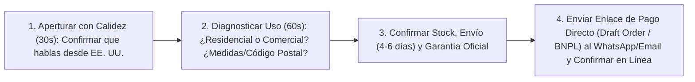

# 📄 Hoja de Referencia Visual (Cheat Sheet) — Módulo 09

## 1. Resumen Ejecutivo del Módulo 09
**Conversión Consultiva: WhatsApp, Teléfono y Chat en Ambos Idiomas** — *Tu mayor ventaja competitiva: guiones probados de venta consultiva, manejo de las 7 objeciones y cierre con enlaces de pago directo (Draft Orders).*

* **Nivel:** Intermedio | **Duración:** 6 horas (2.5 h estudio + 3.5 h práctica de guiones)
* **Prerrequisitos:** Módulo 07 completado
* **Proyecto de la Semana:** Sistema de Cierre Telefónico y WhatsApp Bilingüe Activo
* **Plantilla Asociada:** `m09-guiones-venta-consultiva-whatsapp-telefono.md`

---

## 2. Diagrama Clave de Operación

---

## 3. Reglas de Oro y Lista de Verificación Rápida
* **Ejemplo Numérico Clave:** Un cliente abandona un carrito con un equipo de **US$540** (ganancia neta: **US$85**). A los 20 minutos le envías un WhatsApp cortés o lo llamas: *'Hola Carlos, soy [Tu Nombre] de [Tienda]. Vi que estabas cotizando el modelo de 48 pulgadas para envío a Dallas. Solo quería avisarte que sí lo tenemos en stock listo en la bodega de Texas y te llega en 3 días hábiles. ¿Tuviste alguna duda con las medidas o el método de pago?'*. Si de cada 5 carritos abandonados que contactas recuperas **solo 1**, sumas **US$85 netos libres sin gastar un centavo más en publicidad**.
* **Enfoque Mercado Anglo vs. Hispano:** Si tu nivel de inglés hablado es intermedio, apoya tus cierres en inglés mediante **WhatsApp / SMS / Live Chat con respuestas rápidas pre-redactadas** (donde puedes responder al instante con inglés impecable) y utiliza tus llamadas de voz al 100% con el mercado hispano y en llamadas de verificación puntuales.
* **Error Crítico a Evitar:** Presionar al cliente como un vendedor agresivo de antaño. En *high-ticket*, **no presionas: asesoras**. Cuando le das seguridad técnica, le confirmas el tiempo real de entrega a su código postal y le ofreces pagar con tarjeta o cuotas *BNPL*, el cliente cierra la compra por sí mismo.
