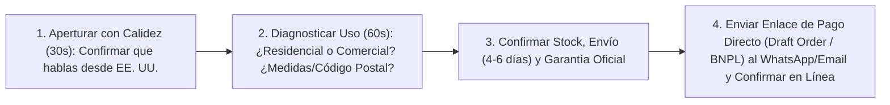

## 🎯 Objetivo de la Lección
Aplicar la estructura de llamada y chat consultivo de 4 pasos: Bienvenida, Diagnóstico de Uso, Recomendación Experta y Cierre con Enlace Directo. Además, aplicarás los principios de **Conversión Consultiva: WhatsApp, Teléfono y Chat en Ambos Idiomas** directamente a tu catálogo de **3 a 10 productos de alto valor (US$150 a US$800)** para el mercado anglo e hispano de Estados Unidos.

---

## 📖 Explicación Sencilla
Tu mayor ventaja competitiva: guiones probados de venta consultiva, manejo de las 7 objeciones y cierre con enlaces de pago directo (Draft Orders).

Para operar con éxito dentro de tus **12 horas semanales** y proteger tu meta de **US$2,500 de ganancia neta mensual**, este módulo se centra en pasos accionables y medibles:
1. **Aplicar la estructura de llamada y chat consultivo de 4 pasos: Bienvenida, Diagnóstico de Uso, Recomendación Experta y Cierre con Enlace Directo.**
2. **Rebatir con naturalidad y honestidad las 7 objeciones del comprador de tickets altos en inglés y español.**
3. **Recuperar carritos abandonados de US$200 a US$800 mediante llamada breve o mensaje personalizado.**
4. **Generar y enviar órdenes borrador (Draft Orders) listas para pagar en 1 clic.**

### Recurso Visual 1: Flujo Operativo del Módulo 09



---

### Recurso Visual 2: Datos e Impacto en Resultados

```chart
{
  "type": "bar",
  "title": "Tasa de Conversión según el Canal de Contacto en Productos de US$300 a US$800 (%)",
  "data": {
    "labels": ["Visitante Web sin Contacto", "Consulta por Email (Respuesta 24h)", "Chat / WhatsApp en < 15 min", "Llamada Telefónica Consultiva (3-5 min)"],
    "datasets": [{
      "label": "% de Visitantes que Compran",
      "data": [1.4, 7.5, 19.0, 32.0],
      "backgroundColor": ["#94A3B8", "#3B82F6", "#10B981", "#E11D48"]
    }]
  }
}
```

> [!EJEMPLO_NUMEROS]
> **Ejemplo con números reales aplicados a tu negocio:**
> Un cliente abandona un carrito con un equipo de **US$540** (ganancia neta: **US$85**). A los 20 minutos le envías un WhatsApp cortés o lo llamas: *'Hola Carlos, soy [Tu Nombre] de [Tienda]. Vi que estabas cotizando el modelo de 48 pulgadas para envío a Dallas. Solo quería avisarte que sí lo tenemos en stock listo en la bodega de Texas y te llega en 3 días hábiles. ¿Tuviste alguna duda con las medidas o el método de pago?'*. Si de cada 5 carritos abandonados que contactas recuperas **solo 1**, sumas **US$85 netos libres sin gastar un centavo más en publicidad**.

> [!ANGLO_VS_HISPANO]
> **Mercado Anglo vs. Hispano en EE. UU.:**
> Si tu nivel de inglés hablado es intermedio, apoya tus cierres en inglés mediante **WhatsApp / SMS / Live Chat con respuestas rápidas pre-redactadas** (donde puedes responder al instante con inglés impecable) y utiliza tus llamadas de voz al 100% con el mercado hispano y en llamadas de verificación puntuales.

> [!ERROR_COMUN]
> **Error común que debes evitar:**
> Presionar al cliente como un vendedor agresivo de antaño. En *high-ticket*, **no presionas: asesoras**. Cuando le das seguridad técnica, le confirmas el tiempo real de entrega a su código postal y le ofreces pagar con tarjeta o cuotas *BNPL*, el cliente cierra la compra por sí mismo.

---

## 🛠️ Ejercicio Práctico Aplicado a tu Negocio
1. Descarga la plantilla **`m09-guiones-venta-consultiva-whatsapp-telefono.md`** desde el botón de esta lección o desde la Biblioteca de Plantillas.
2. Completa tu entregable de la semana: **Sistema de Cierre Telefónico y WhatsApp Bilingüe Activo** (Configurar tu línea de EE. UU. y WhatsApp Business con respuestas rápidas en inglés y español y practicar el cierre de las 7 objeciones con enlaces de Draft Order.).

---

## ✅ Checklist de la Lección
- [ ] `Mi botón de WhatsApp y mi número telefónico en EE. UU. están activos y con mensaje de bienvenida bilingüe.`
- [ ] `Personalicé la plantilla m09-guiones-venta-consultiva-whatsapp-telefono.md con los datos de mis productos.`
- [ ] `Sé crear un Draft Order en menos de 60 segundos mientras hablo con un cliente.`

---

## 🧠 Mini Quiz de Comprobación

```quiz
[
  {
    "pregunta": "1. ¿Cuál es el objetivo principal de los primeros 60 segundos de una conversación por teléfono o WhatsApp con un comprador de un producto de US$450?",
    "opciones": [
      "Pedirle los 16 dígitos de su tarjeta por teléfono.",
      "Hacer un diagnóstico consultivo breve: preguntarle para qué proyecto o espacio lo necesita y su código postal (ZIP code) para confirmarle que el modelo es el adecuado y cuánto tardará en llegarle.",
      "Hablar durante 20 minutos sin parar.",
      "Ofrecerle un 50% de descuento."
    ],
    "correcta": 1,
    "explicacion": "Cuando preguntas por su necesidad y su código postal, te posicionas como un experto confiable y eliminas sus dos mayores miedos: equivocarse de modelo y que el envío tarde demasiado."
  },
  {
    "pregunta": "2. ¿Qué herramienta de la tienda utilizas para facilitarle el pago al cliente mientras estás hablando con él por teléfono o WhatsApp?",
    "opciones": [
      "Decirle que busque de nuevo la tienda en Google.",
      "Crear una Orden Borrador (Draft Order) con sus datos y enviarle el enlace directo de checkout a su WhatsApp o correo para que pague en 1 clic con tarjeta o cuotas BNPL.",
      "Pedirle un cheque por correo postal.",
      "Enviar el producto sin cobrar."
    ],
    "correcta": 1,
    "explicacion": "El enlace directo de Draft Order lleva al cliente directo a la pantalla de pago segura con el producto y el envío ya cargados, evitando que se distraiga o abandone."
  },
  {
    "pregunta": "3. Si un cliente te dice: 'Me interesa el equipo de US$600, pero hoy se me hace pesado pagarlo de contado', ¿cuál es tu respuesta consultiva correcta?",
    "opciones": [
      "Decirle que vuelva el próximo año.",
      "Explicarle que en el enlace de pago puede seleccionar Shop Pay Installments o Affirm para dividirlo en 4 pagos sin intereses o cuotas mensuales y recibir el producto esta misma semana.",
      "Rebajar el precio a US$200 perdiendo dinero.",
      "Fiarle de palabra."
    ],
    "correcta": 1,
    "explicacion": "El financiamiento BNPL resuelve la objeción de liquidez inmediata del comprador mientras tú recibes el pago completo de la plataforma."
  }
]
```

---

## 🎯 Entregable de la Lección
Completa tu archivo **`m09-guiones-venta-consultiva-whatsapp-telefono.md`** y marca los criterios del **Checkpoint del Módulo 09** cuando estés listo/a para avanzar.
