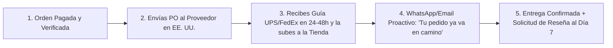

# 📄 Hoja de Referencia Visual (Cheat Sheet) — Módulo 10

## 1. Resumen Ejecutivo del Módulo 10
**Operaciones y Servicio: Flujo del Pedido, Seguimiento, Devoluciones y Plantillas** — *Cómo procesar pedidos en 15 minutos al día, mantener informado al comprador, gestionar garantías/devoluciones (RMA) y conseguir reseñas de 5 estrellas.*

* **Nivel:** Intermedio | **Duración:** 5 horas (2 h estudio + 3 h SOPs y plantillas)
* **Prerrequisitos:** Módulos 02, 06 y 09 completados
* **Proyecto de la Semana:** Manual SOP de Operaciones en 15 Minutos y Kit de 12 Mensajes Postventa
* **Plantilla Asociada:** `m10-manual-sop-pedidos-y-mensajes-postventa.md`

---

## 2. Diagrama Clave de Operación

---

## 3. Reglas de Oro y Lista de Verificación Rápida
* **Ejemplo Numérico Clave:** Cuando alguien paga **US$500** en internet, siente ansiedad hasta que ve que el paquete realmente se mueve en manos de UPS o FedEx. Si le envías un mensaje personalizado a las 24 horas (*'Hola María, tu equipo ya fue asignado en nuestra bodega de Ohio y mañana a primera hora sale con guía de FedEx'*), reduces las cancelaciones por ansiedad a **menos del 0.5%**.
* **Enfoque Mercado Anglo vs. Hispano:** Configura tus notificaciones de envío y entrega en el idioma en que compró el cliente. Una llamada o mensaje de WhatsApp de 30 segundos el día en que el camión va a entregar un paquete pesado (*'Hoy entre las 2pm y 5pm llega FedEx con tu pedido'*) genera las mejores reseñas de 5 estrellas tanto en inglés como en español.
* **Error Crítico a Evitar:** Autorizar a un cliente a devolver un producto a la dirección de tu casa o de tu oficina registrada en lugar de solicitar primero el **número RMA y la dirección exacta de la bodega de devoluciones del proveedor**.
