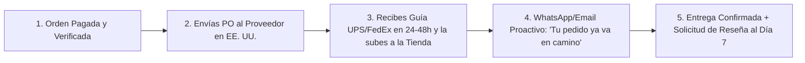

## 🎯 Objetivo de la Lección
Ejecutar el ciclo completo de una orden (Cobro -> Semáforo Antifraude -> Orden de Compra PO al proveedor -> Guía de rastreo -> Entrega). Además, aplicarás los principios de **Operaciones y Servicio: Flujo del Pedido, Seguimiento, Devoluciones y Plantillas** directamente a tu catálogo de **3 a 10 productos de alto valor (US$150 a US$800)** para el mercado anglo e hispano de Estados Unidos.

---

## 📖 Explicación Sencilla
Cómo procesar pedidos en 15 minutos al día, mantener informado al comprador, gestionar garantías/devoluciones (RMA) y conseguir reseñas de 5 estrellas.

Para operar con éxito dentro de tus **12 horas semanales** y proteger tu meta de **US$2,500 de ganancia neta mensual**, este módulo se centra en pasos accionables y medibles:
1. **Ejecutar el ciclo completo de una orden (Cobro -> Semáforo Antifraude -> Orden de Compra PO al proveedor -> Guía de rastreo -> Entrega).**
2. **Reducir la ansiedad post-compra del cliente mediante notificaciones proactivas en su idioma.**
3. **Gestionar daños en tránsito y devoluciones (RMA) sin perder dinero gracias a las pólizas del proveedor.**
4. **Recolectar reseñas verificadas con foto para elevar la conversión futura.**

### Recurso Visual 1: Flujo Operativo del Módulo 10



---

### Recurso Visual 2: Datos e Impacto en Resultados

```chart
{
  "type": "bar",
  "title": "Tasa de Disputas/Cancelaciones según la Velocidad de Comunicación Postventa (%)",
  "data": {
    "labels": ["Sin Aviso hasta los 5 días", "Solo Email Automático Genérico", "Email + WhatsApp Personalizado con Guía en <48h"],
    "datasets": [{
      "label": "% de Clientes que Cancelan o Abren Disputa por Ansiedad",
      "data": [11.5, 3.8, 0.4],
      "backgroundColor": ["#EF4444", "#F59E0B", "#0D9488"]
    }]
  }
}
```

> [!EJEMPLO_NUMEROS]
> **Ejemplo con números reales aplicados a tu negocio:**
> Cuando alguien paga **US$500** en internet, siente ansiedad hasta que ve que el paquete realmente se mueve en manos de UPS o FedEx. Si le envías un mensaje personalizado a las 24 horas (*'Hola María, tu equipo ya fue asignado en nuestra bodega de Ohio y mañana a primera hora sale con guía de FedEx'*), reduces las cancelaciones por ansiedad a **menos del 0.5%**.

> [!ANGLO_VS_HISPANO]
> **Mercado Anglo vs. Hispano en EE. UU.:**
> Configura tus notificaciones de envío y entrega en el idioma en que compró el cliente. Una llamada o mensaje de WhatsApp de 30 segundos el día en que el camión va a entregar un paquete pesado (*'Hoy entre las 2pm y 5pm llega FedEx con tu pedido'*) genera las mejores reseñas de 5 estrellas tanto en inglés como en español.

> [!ERROR_COMUN]
> **Error común que debes evitar:**
> Autorizar a un cliente a devolver un producto a la dirección de tu casa o de tu oficina registrada en lugar de solicitar primero el **número RMA y la dirección exacta de la bodega de devoluciones del proveedor**.

---

## 🛠️ Ejercicio Práctico Aplicado a tu Negocio
1. Descarga la plantilla **`m10-manual-sop-pedidos-y-mensajes-postventa.md`** desde el botón de esta lección o desde la Biblioteca de Plantillas.
2. Completa tu entregable de la semana: **Manual SOP de Operaciones en 15 Minutos y Kit de 12 Mensajes Postventa** (Implementar tu rutina diaria de procesamiento de órdenes (PO), carga de números de guía y protocolos de devolución/daño en tránsito en inglés y español.).

---

## ✅ Checklist de la Lección
- [ ] `Tengo mi rutina diaria de 15 minutos documentada en m10-manual-sop-pedidos-y-mensajes-postventa.md.`
- [ ] `Conozco la diferencia entre procesar una devolución por daño en transporte (costo US$0 para ti) y una por cambio de opinión (con restocking fee).`
- [ ] `Configuré el mensaje automático de solicitud de reseña 7 días después de la entrega.`

---

## 🧠 Mini Quiz de Comprobación

```quiz
[
  {
    "pregunta": "1. Si un cliente te escribe diciendo que quiere devolver un producto de US$420 porque cambió de opinión (sin abrir la caja), ¿cuál es el paso #1 obligatorio?",
    "opciones": [
      "Decirle que lo mande a la dirección de tu casa.",
      "Solicitar a tu proveedor el número de autorización RMA y la dirección exacta de su bodega de retornos, e indicarle al cliente el proceso aplicando la guía de retorno y el restocking fee estipulado en tu política.",
      "Reembolsarle todo el dinero antes de que envíe el producto.",
      "Bloquear su número."
    ],
    "correcta": 1,
    "explicacion": "Todo retorno debe ir directamente a la bodega del proveedor con su número RMA oficial; y nunca se emite el reembolso hasta que la bodega confirma la recepción e inspección."
  },
  {
    "pregunta": "2. ¿Qué pasa si un producto llega con una pieza golpeada por culpa de UPS o FedEx?",
    "opciones": [
      "Tú pierdes todo el dinero.",
      "Le pides al cliente 2 fotos del daño y de la caja dentro de las primeras 48 horas, se las envías al departamento de garantías/reclamos del proveedor y el proveedor envía la pieza de repuesto o una unidad nueva sin costo para ti ni para el cliente.",
      "Le dices al cliente que lo pegue con cinta.",
      "Cierras la tienda."
    ],
    "correcta": 1,
    "explicacion": "En la mayoría de las ocasiones, enviar una pieza de repuesto desde la bodega del fabricante resuelve el problema en 3 días sin tener que devolver toda la caja."
  },
  {
    "pregunta": "3. ¿Cuánto tiempo diario requiere procesar 2 a 3 pedidos en una operación bien estandarizada con nuestro SOP?",
    "opciones": [
      "8 horas diarias.",
      "Entre 15 y 25 minutos al día siguiendo la lista de control paso a paso.",
      "40 horas por pedido.",
      "Todo el fin de semana."
    ],
    "correcta": 1,
    "explicacion": "Con pocos pedidos de alto margen, procesar las órdenes de compra (PO) y actualizar números de rastreo toma menos de 20 minutos diarios."
  }
]
```

---

## 🎯 Entregable de la Lección
Completa tu archivo **`m10-manual-sop-pedidos-y-mensajes-postventa.md`** y marca los criterios del **Checkpoint del Módulo 10** cuando estés listo/a para avanzar.
