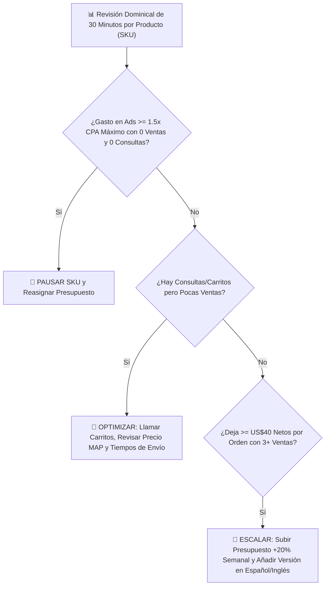

# 📄 Hoja de Referencia Visual (Cheat Sheet) — Módulo 11

## 1. Resumen Ejecutivo del Módulo 11
**Analítica y Escalamiento: KPIs, Cuándo Pausar o Escalar y Automatización** — *Cómo leer tus números en 30 minutos cada domingo, apagar lo que no funciona sin apego emocional y escalar los productos ganadores.*

* **Nivel:** Avanzado | **Duración:** 6 horas (3 h estudio + 3 h tablero de control)
* **Prerrequisitos:** Módulos 03, 08 y 10 completados
* **Proyecto de la Semana:** Tablero Semanal de Resultados (P&L) y Reglas de Escalamiento
* **Plantilla Asociada:** `m11-tablero-semanal-kpis-y-reglas-escala.csv`

---

## 2. Diagrama Clave de Operación

---

## 3. Reglas de Oro y Lista de Verificación Rápida
* **Ejemplo Numérico Clave:** Tienes 5 productos en prueba. Después de invertir **US$450**, ves que el **Producto #2** generó **4 ventas con US$75 netos cada una (+US$300)**, mientras que el **Producto #5** consumió **US$140 de anuncios con 0 ventas y 0 preguntas por WhatsApp**. Aplicas tu regla sin apego emocional: **apagas el Producto #5** y pasas su presupuesto al **Producto #2** y a su versión en español.
* **Enfoque Mercado Anglo vs. Hispano:** En tu tablero semanal (`m11-tablero-semanal-kpis-y-reglas-escala.csv`), mide por separado el **ROAS en Inglés** y el **ROAS en Español**. Con frecuencia descubrirás que un producto que en inglés tiene un ROAS ajustado de `4.2x`, en español dentro de EE. UU. alcanza `6.8x` gracias al menor costo por clic y a tu cierre telefónico.
* **Error Crítico a Evitar:** Duplicar o triplicar de golpe el presupuesto diario de una campaña ganadora de un día para otro (ej. pasar de US$20/día a US$100/día). Eso descalibra el algoritmo de puja y dispara tu CPA; escala siempre en incrementos graduales del **15% al 25% cada 5 a 7 días**.
