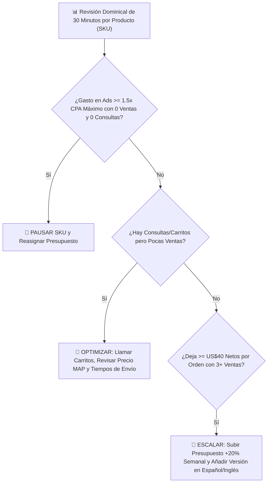

## 🎯 Objetivo de la Lección
Medir semanalmente los indicadores que importan: Ganancia Neta Real, ROAS Global (MER), CPA por Producto y Tasa de Cierre Consultivo. Además, aplicarás los principios de **Analítica y Escalamiento: KPIs, Cuándo Pausar o Escalar y Automatización** directamente a tu catálogo de **3 a 10 productos de alto valor (US$150 a US$800)** para el mercado anglo e hispano de Estados Unidos.

---

## 📖 Explicación Sencilla
Cómo leer tus números en 30 minutos cada domingo, apagar lo que no funciona sin apego emocional y escalar los productos ganadores.

Para operar con éxito dentro de tus **12 horas semanales** y proteger tu meta de **US$2,500 de ganancia neta mensual**, este módulo se centra en pasos accionables y medibles:
1. **Medir semanalmente los indicadores que importan: Ganancia Neta Real, ROAS Global (MER), CPA por Producto y Tasa de Cierre Consultivo.**
2. **Aplicar reglas matemáticas de Stop-Loss (cuándo pausar un producto) y Escalamiento (+20% de presupuesto semanal).**
3. **Expandir tu catálogo de 3-5 productos validados hasta 8-10 productos complementarios de alto margen.**
4. **Automatizar la actualización de inventario y reportes para mantener tu operación dentro de tus 12 horas semanales.**

### Recurso Visual 1: Flujo Operativo del Módulo 11



---

### Recurso Visual 2: Datos e Impacto en Resultados

```chart
{
  "type": "line",
  "title": "Proyección de Ganancia Neta Mensual al Optimizar y Escalar SKUs Ganadores (US$)",
  "data": {
    "labels": ["Mes 1 (Pruebas)", "Mes 2 (Primeros Ganadores)", "Mes 3 (Poda y Escala)", "Mes 4 (Operación Estable)"],
    "datasets": [
      {"label": "Gasto Publicitario Mensual (US$)", "data": [600, 950, 1400, 1800], "borderColor": "#F59E0B", "backgroundColor": "rgba(245,158,11,0.15)"},
      {"label": "Ganancia Neta Libre después de Todos los Costos (US$)", "data": [320, 1150, 2100, 2850], "borderColor": "#10B981", "backgroundColor": "rgba(16,185,129,0.2)"}
    ]
  }
}
```

> [!EJEMPLO_NUMEROS]
> **Ejemplo con números reales aplicados a tu negocio:**
> Tienes 5 productos en prueba. Después de invertir **US$450**, ves que el **Producto #2** generó **4 ventas con US$75 netos cada una (+US$300)**, mientras que el **Producto #5** consumió **US$140 de anuncios con 0 ventas y 0 preguntas por WhatsApp**. Aplicas tu regla sin apego emocional: **apagas el Producto #5** y pasas su presupuesto al **Producto #2** y a su versión en español.

> [!ANGLO_VS_HISPANO]
> **Mercado Anglo vs. Hispano en EE. UU.:**
> En tu tablero semanal (`m11-tablero-semanal-kpis-y-reglas-escala.csv`), mide por separado el **ROAS en Inglés** y el **ROAS en Español**. Con frecuencia descubrirás que un producto que en inglés tiene un ROAS ajustado de `4.2x`, en español dentro de EE. UU. alcanza `6.8x` gracias al menor costo por clic y a tu cierre telefónico.

> [!ERROR_COMUN]
> **Error común que debes evitar:**
> Duplicar o triplicar de golpe el presupuesto diario de una campaña ganadora de un día para otro (ej. pasar de US$20/día a US$100/día). Eso descalibra el algoritmo de puja y dispara tu CPA; escala siempre en incrementos graduales del **15% al 25% cada 5 a 7 días**.

---

## 🛠️ Ejercicio Práctico Aplicado a tu Negocio
1. Descarga la plantilla **`m11-tablero-semanal-kpis-y-reglas-escala.csv`** desde el botón de esta lección o desde la Biblioteca de Plantillas.
2. Completa tu entregable de la semana: **Tablero Semanal de Resultados (P&L) y Reglas de Escalamiento** (Configurar tu hoja de control semanal con los 8 KPIs vitales y firmar tus reglas matemáticas para pausar, optimizar o escalar campañas y productos.).

---

## ✅ Checklist de la Lección
- [ ] `Tengo mi plantilla m11-tablero-semanal-kpis-y-reglas-escala.csv lista para mi revisión de cada domingo.`
- [ ] `Sé diagnosticar en 5 minutos si un problema de ventas viene de falta de clics (CTR), costo por clic alto (CPC) o baja conversión en la página.`
- [ ] `Establecí mis reglas de pausa y escalamiento sin decisiones emocionales.`

---

## 🧠 Mini Quiz de Comprobación

```quiz
[
  {
    "pregunta": "1. ¿Cuál es la regla correcta cuando un producto ha gastado 1.5 veces tu CPA Máximo Permitido en clics calificados sin generar ninguna venta ni consulta por WhatsApp/teléfono?",
    "opciones": [
      "Meterle el triple de dinero esperando un milagro.",
      "Aplicar la regla de Stop-Loss: pausar los anuncios de ese producto y concentrar el presupuesto en los productos que sí están generando consultas y ventas rentables.",
      "Borrar toda la tienda.",
      "No revisar los números durante un mes."
    ],
    "correcta": 1,
    "explicacion": "En un catálogo de 5 a 10 productos, la Ley de Pareto (80/20) es normal: 2 o 3 productos estrella generarán el 80% de tus ganancias netas."
  },
  {
    "pregunta": "2. Si un producto tiene muchos clics y los usuarios llegan a la página e incluso preguntan por WhatsApp, pero nadie termina comprando, ¿dónde está el cuello de botella?",
    "opciones": [
      "En el anuncio.",
      "En la conversión / oferta (precio fuera de mercado, falta de confianza, tiempos de envío confusos o falta de seguimiento en el cierre consultivo).",
      "En el nombre del dominio.",
      "En el color del logo."
    ],
    "correcta": 1,
    "explicacion": "Si hay tráfico y consultas, el anuncio funciona; debes auditar el precio frente a competidores, activar BNPL y mejorar el seguimiento telefónico con Draft Orders."
  },
  {
    "pregunta": "3. ¿A qué ritmo se recomienda aumentar el presupuesto de una campaña que ya es rentable?",
    "opciones": [
      "Multiplicarlo por 10 el mismo día.",
      "Aumentar entre un 15% y un 25% cada 5 a 7 días mientras el CPA se mantenga por debajo de tu objetivo y tu flujo de caja lo permita.",
      "Bajarlo a cero.",
      "Cambiar todos los textos del anuncio que ya funciona."
    ],
    "correcta": 1,
    "explicacion": "El escalamiento gradual mantiene estable el costo por adquisición y te permite cuidar tu capital de trabajo."
  }
]
```

---

## 🎯 Entregable de la Lección
Completa tu archivo **`m11-tablero-semanal-kpis-y-reglas-escala.csv`** y marca los criterios del **Checkpoint del Módulo 11** cuando estés listo/a para avanzar.
