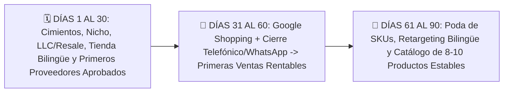

# 📄 Hoja de Referencia Visual (Cheat Sheet) — Módulo 12

## 1. Resumen Ejecutivo del Módulo 12
**Plan de Lanzamiento de 30, 60 y 90 Días y Proyecto Final** — *Tu hoja de ruta semana por semana para pasar de cero a tu primera venta y consolidar una operación estable hacia tu meta de US$2,500 netos mensuales.*

* **Nivel:** Avanzado | **Duración:** 6 horas de planificación + Ejecución guiada de 90 días
* **Prerrequisitos:** Módulos 00 al 11 completados
* **Proyecto de la Semana:** Dossier Operativo de Lanzamiento y Auditoría de 50 Puntos
* **Plantilla Asociada:** `m12-plan-ejecucion-30-60-90-dias.csv`

---

## 2. Diagrama Clave de Operación

---

## 3. Reglas de Oro y Lista de Verificación Rápida
* **Ejemplo Numérico Clave:** Mira cómo encajan tus **12 horas semanales** en la **Fase de Operación Estable (Días 61 a 90)**:
* **Procesamiento diario de pedidos (SOP):** 20 min/día de lunes a viernes = **1.7 horas/semana**.
* **Atención de llamadas y WhatsApp de clientes indecisos:** ~1 hora/día hábil = **6 horas/semana** (la actividad que más dinero te genera).
* **Revisión dominical de campañas y KPIs:** **2 horas el domingo**.
* **Relación con proveedores y mejora de catálogo:** **2.3 horas/semana**.
* **Total:** **12 horas/semana** bien enfocadas hacia tu meta de **US$2,500 netos mensuales**.
* **Enfoque Mercado Anglo vs. Hispano:** Al llegar al **Día 60**, revisa qué porcentaje de tus ventas provino del **mercado anglo** y qué porcentaje del **mercado hispano en EE. UU.** Muchos alumnos descubren que aunque el 65% del tráfico viene en inglés, el 50% de las ventas cerradas por teléfono y WhatsApp provienen de clientes hispanos que agradecieron ser atendidos en su idioma con garantía en EE. UU.
* **Error Crítico a Evitar:** Saltarse la Fase de los Días 1 al 30 y querer prender anuncios de pago con una tienda a medio traducir, sin haber calculado el Peso Dimensional ni tener proveedores confirmados.
