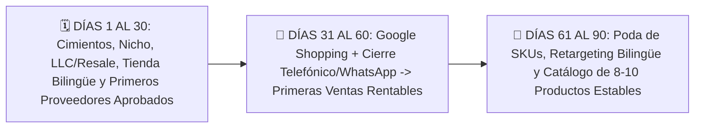

## 🎯 Objetivo de la Lección
Seguir una agenda realista de 12 horas semanales dividida en bloques de 30, 60 y 90 días sin abrumarte. Además, aplicarás los principios de **Plan de Lanzamiento de 30, 60 y 90 Días y Proyecto Final** directamente a tu catálogo de **3 a 10 productos de alto valor (US$150 a US$800)** para el mercado anglo e hispano de Estados Unidos.

---

## 📖 Explicación Sencilla
Tu hoja de ruta semana por semana para pasar de cero a tu primera venta y consolidar una operación estable hacia tu meta de US$2,500 netos mensuales.

Para operar con éxito dentro de tus **12 horas semanales** y proteger tu meta de **US$2,500 de ganancia neta mensual**, este módulo se centra en pasos accionables y medibles:
1. **Seguir una agenda realista de 12 horas semanales dividida en bloques de 30, 60 y 90 días sin abrumarte.**
2. **Superar la Auditoría de Lanzamiento para asegurar que no existan fugas de dinero ni riesgos de bloqueo antes de invertir en tráfico.**
3. **Alcanzar tus primeras ventas consultivas entre el Día 31 y el Día 60.**
4. **Estabilizar un catálogo ganador de 5 a 10 productos entre el Día 61 y el Día 90.**

### Recurso Visual 1: Flujo Operativo del Módulo 12



---

### Recurso Visual 2: Datos e Impacto en Resultados

```chart
{
  "type": "bar",
  "title": "Distribución de tus 12 Horas Semanales en Cada Fase del Plan 30-60-90 (Horas/Semana)",
  "data": {
    "labels": ["Días 1-30 (Construcción y Proveedores)", "Días 31-60 (Tráfico y Cierre Consultivo)", "Días 61-90 (Operación y Escala)"],
    "datasets": [
      {"label": "Investigación, Tienda y Proveedores (h)", "data": [9, 3, 2], "backgroundColor": "#4F46E5"},
      {"label": "Atención Telefónica / WhatsApp y Cierre de Ventas (h)", "data": [1, 6, 6], "backgroundColor": "#E11D48"},
      {"label": "Campañas, Pedidos (SOP) y Analítica (h)", "data": [2, 3, 4], "backgroundColor": "#10B981"}
    ]
  }
}
```

> [!EJEMPLO_NUMEROS]
> **Ejemplo con números reales aplicados a tu negocio:**
> Mira cómo encajan tus **12 horas semanales** en la **Fase de Operación Estable (Días 61 a 90)**:
* **Procesamiento diario de pedidos (SOP):** 20 min/día de lunes a viernes = **1.7 horas/semana**.
* **Atención de llamadas y WhatsApp de clientes indecisos:** ~1 hora/día hábil = **6 horas/semana** (la actividad que más dinero te genera).
* **Revisión dominical de campañas y KPIs:** **2 horas el domingo**.
* **Relación con proveedores y mejora de catálogo:** **2.3 horas/semana**.
* **Total:** **12 horas/semana** bien enfocadas hacia tu meta de **US$2,500 netos mensuales**.

> [!ANGLO_VS_HISPANO]
> **Mercado Anglo vs. Hispano en EE. UU.:**
> Al llegar al **Día 60**, revisa qué porcentaje de tus ventas provino del **mercado anglo** y qué porcentaje del **mercado hispano en EE. UU.** Muchos alumnos descubren que aunque el 65% del tráfico viene en inglés, el 50% de las ventas cerradas por teléfono y WhatsApp provienen de clientes hispanos que agradecieron ser atendidos en su idioma con garantía en EE. UU.

> [!ERROR_COMUN]
> **Error común que debes evitar:**
> Saltarse la Fase de los Días 1 al 30 y querer prender anuncios de pago con una tienda a medio traducir, sin haber calculado el Peso Dimensional ni tener proveedores confirmados.

---

## 🛠️ Ejercicio Práctico Aplicado a tu Negocio
1. Descarga la plantilla **`m12-plan-ejecucion-30-60-90-dias.csv`** desde el botón de esta lección o desde la Biblioteca de Plantillas.
2. Completa tu entregable de la semana: **Dossier Operativo de Lanzamiento y Auditoría de 50 Puntos** (Completar la revisión final de tu negocio (catálogo, economía unitaria, proveedores, tienda bilingüe, pagos/BNPL, campañas y guiones) y ejecutar el calendario de 30, 60 y 90 días.).

---

## ✅ Checklist de la Lección
- [ ] `Descargué y personalicé mi cronograma m12-plan-ejecucion-30-60-90-dias.csv con fechas reales.`
- [ ] `Mi tienda, mis cuentas de proveedor, mis calculadoras de margen y mis guiones bilingües están 100% listos.`
- [ ] `¡Estoy listo/a para lanzar y operar mi negocio de High-Ticket Dropshipping Bilingüe en EE. UU.!`

---

## 🧠 Mini Quiz de Comprobación

```quiz
[
  {
    "pregunta": "1. ¿Cuál es la meta principal de los primeros 30 días de nuestro plan?",
    "opciones": [
      "Gastar todo el presupuesto de publicidad el primer día sin tener proveedores.",
      "Dejar construidos los cimientos sólidos: selección de productos con >= US$40 de ganancia neta, documentación legal/Resale Certificate, tienda bilingüe activa y primeros proveedores autorizados aprobados en EE. UU.",
      "Diseñar 50 logos distintos.",
      "Contratar 10 empleados."
    ],
    "correcta": 1,
    "explicacion": "Los primeros 30 días construyen el activo comercial y aseguran márgenes y proveedores antes de arriesgar un solo dólar en anuncios."
  },
  {
    "pregunta": "2. Entre los Días 31 y 90, ¿a qué actividad le dedicarás la mayor parte de tus 12 horas semanales (aprox. 6 h/semana) porque es la que multiplica tu rentabilidad?",
    "opciones": [
      "A cambiar los colores de la página web todos los días.",
      "A la conversión consultiva: atender llamadas telefónicas, responder consultas de WhatsApp en inglés y español y enviar enlaces de pago (Draft Orders) a compradores interesados.",
      "A ver redes sociales.",
      "A discutir en foros."
    ],
    "correcta": 1,
    "explicacion": "Tu habilidad en ventas por teléfono y servicio al cliente es el motor que convierte clics en ganancias netas de US$60 a US$120 por pedido."
  },
  {
    "pregunta": "3. Antes de encender tu primera campaña en el Día 31, ¿qué debes verificar sin excepción?",
    "opciones": [
      "Que cada producto publicado respete el precio MAP, deje >= US$40 netos en la calculadora, tenga stock verificado en EE. UU., pasarela/BNPL probada y tu línea telefónica/WhatsApp funcionando.",
      "Que esté lloviendo.",
      "Que tengas 500 productos subidos.",
      "Nada."
    ],
    "correcta": 0,
    "explicacion": "Esa verificación previa garantiza que cada visitante por el que pagues pueda convertirse en una venta rentable y entregada a tiempo."
  }
]
```

---

## 🎯 Entregable de la Lección
Completa tu archivo **`m12-plan-ejecucion-30-60-90-dias.csv`** y marca los criterios del **Checkpoint del Módulo 12** cuando estés listo/a para avanzar.
